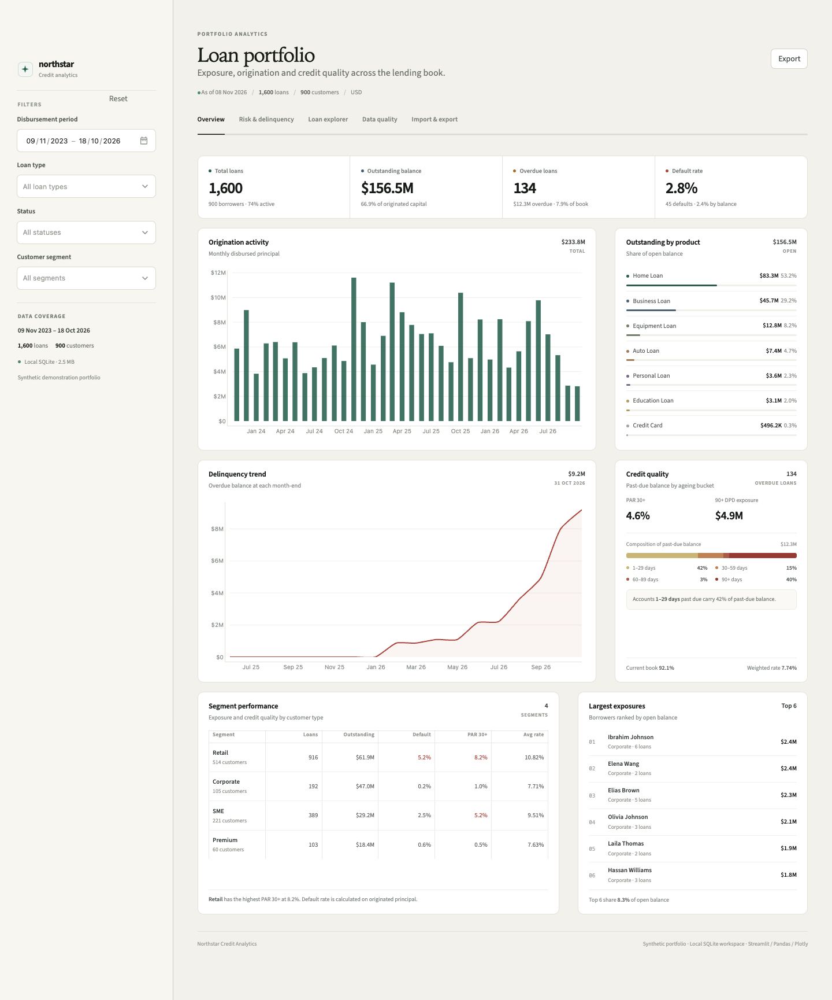
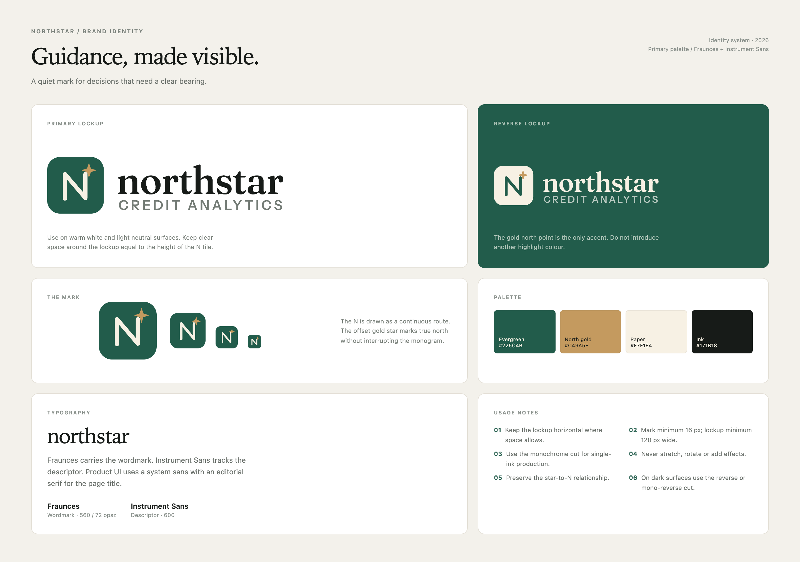
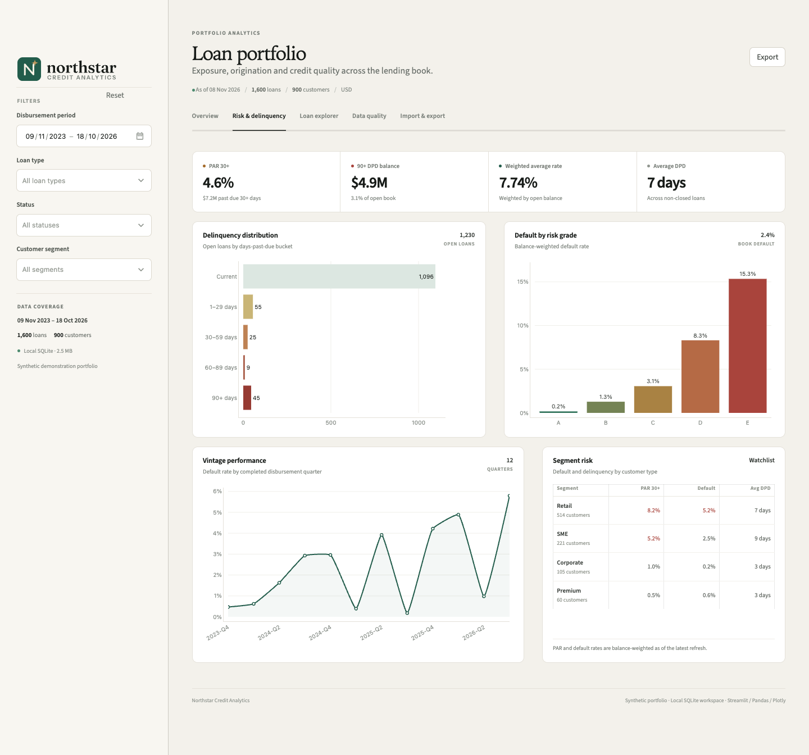
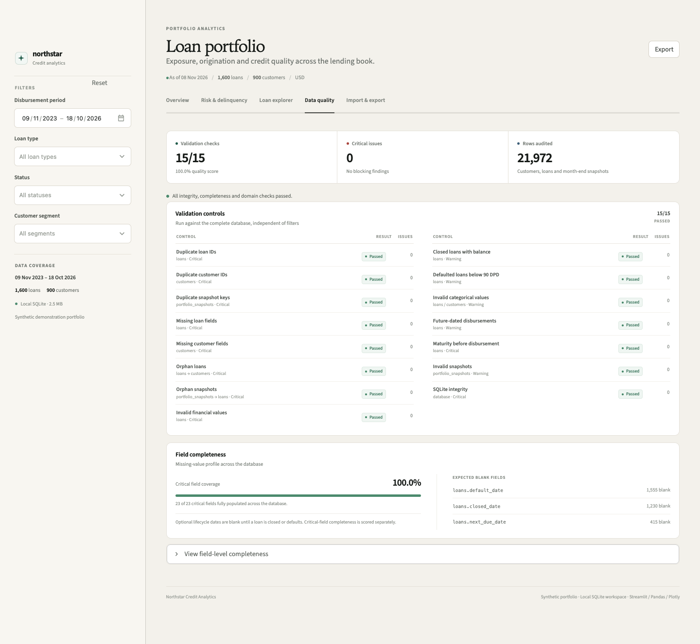
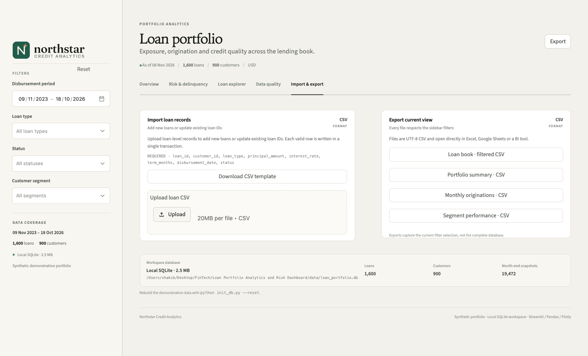
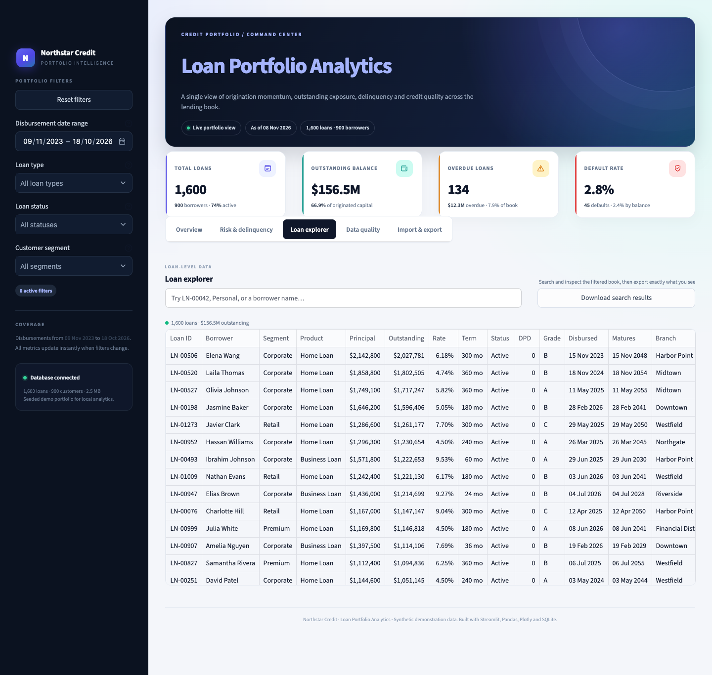

# Northstar — Loan Portfolio Analytics Dashboard


A local-first portfolio analytics workspace for a consumer and commercial lending book. It combines a relational SQLite database, parameterized SQL analytics, Streamlit, Pandas and Plotly into one lightweight application.

The interface is intentionally calm and typography-led: a warm neutral canvas, a light filter sidebar, deep green accents, hairline card borders and compact analytical tables. There are no external UI libraries or font CDNs to configure.

The demo portfolio contains **1,600 loans across 900 customers**, 18 months of month-end snapshots, realistic delinquency and default behaviour, and a complete CSV import/export workflow.



### Brand identity

The product has a custom vector identity: an N monogram built as a continuous route, a small gold north point, and an editorial Fraunces wordmark. The primary lockup, reversed, monochrome, stacked and mark-only cuts are available in [`assets/`](assets/), with palette, clearspace and usage guidance in the [brand guide](docs/brand.md).



---

## Documentation

Full project documentation lives in [`docs/`](docs/README.md):

| Document | Covers |
|---|---|
| [Documentation home](docs/README.md) | Product overview, use cases, conventions and quick navigation |
| [Architecture](docs/architecture.md) | Components, request lifecycle, filtering, snapshots, import architecture, caching and scaling |
| [Data model](docs/data-model.md) | Schema, field dictionary, lifecycle rules, generation logic and CSV contract |
| [Metrics and analytics](docs/metrics.md) | Every KPI definition, denominator, query catalogue and interpretation caveats |
| [User guide](docs/user-guide.md) | Tab-by-tab walkthrough, filter semantics, imports, exports and workflows |
| [Implementation guide](docs/implementation-guide.md) | Use cases, real-data mapping, pilot options, production gaps and phased roadmap |
| [Operations](docs/operations.md) | Setup, runbook, backups, security, scaling, testing and troubleshooting |
| [Glossary](docs/glossary.md) | Definitions for DPD, PAR, ECL and other terms |
| [Brand guide](docs/brand.md) | Identity system, palette, typography and usage |

---

## Highlights

- **Executive overview** — total loans, outstanding balance, overdue loans and default rate, plus origination activity, product allocation, delinquency trends, segment performance and largest exposures.
- **Risk & delinquency** — PAR 30+, 90+ DPD exposure, weighted average rate, DPD buckets, default rate by risk grade, completed-vintage quality and segment-level risk.
- **Loan explorer** — a clean searchable loan grid, live totals and an export of the current search result.
- **Data quality center** — 15 duplicate, missing-value, referential-integrity and business-rule checks, plus a field-level completeness scan.
- **CSV operations** — validated loan import with row-level errors and safe defaults, plus filtered loan-book, portfolio-summary, monthly-origination and segment-performance exports.
- **Interactive filters** — disbursement date range, loan type, loan status and customer segment, applied consistently across every tab through SQL.
- **Reproducible demo data** — seeded generator and one-command database reset.

---

## Quick start

### Requirements

- Python **3.11+** (3.11 recommended)
- SQLite (bundled with Python, no server required)
- No external services or API keys

### Run locally

```bash
# 1. Create and activate a virtual environment
python3 -m venv .venv
source .venv/bin/activate            # Windows: .venv\Scripts\activate

# 2. Install dependencies
pip install -r requirements.txt

# 3. Create the demo database and sample CSVs
python init_db.py

# 4. Launch the dashboard
streamlit run app.py
```

Open the local URL printed by Streamlit, normally <http://localhost:8501>.

> The application also auto-creates `data/loan_portfolio.db` on first launch if the file is missing. Running `init_db.py` explicitly is recommended because it also writes the sample CSVs.

### Rebuild the demo data

```bash
python init_db.py --reset
```

Optional parameters:

```bash
python init_db.py --reset --loans 2500 --customers 1200 --seed 2026
python init_db.py --db /tmp/my_portfolio.db --no-sample
```

| Flag | Default | Purpose |
|---|---|---|
| `--reset` | off | Delete and rebuild the SQLite database |
| `--loans` | `1600` | Number of generated loans |
| `--customers` | `900` | Number of generated customers |
| `--seed` | `42` | Reproducible random seed |
| `--no-sample` | off | Skip writing CSV sample files |
| `--db` | `data/loan_portfolio.db` | Alternative database path |

---

## Screenshots

### Risk & delinquency



### Data quality



### Import & export



### Loan explorer



### Screenshot guidance

The images in `docs/screenshots/` were captured at **1440 px wide**, with all sidebar filters cleared (date range left at full coverage) and the browser at 100% zoom.

To refresh them:

1. Run the app with `streamlit run app.py`.
2. Use **Reset** at the top of the filter sidebar to clear every filter, then leave the disbursement period at full coverage.
3. Set a browser viewport of **1440 px** wide and wait for the Plotly transitions to finish.
4. Capture each tab at full page height. Recommended filenames:
   - `docs/screenshots/overview.png` — Overview tab
   - `docs/screenshots/risk.png` — Risk & delinquency tab
   - `docs/screenshots/quality.png` — Data quality tab
   - `docs/screenshots/import_export.png` — Import & export tab
   - `docs/screenshots/explorer.png` — Loan explorer tab
5. Keep the light filter sidebar, the page header and the footer in frame. Current tabs are roughly 850–1,800 px tall at this width.
6. Use **Overview** for the primary README screenshot and keep the **Overview** tab active so the navigation underline and content agree.
7. If you use a different viewport, keep the same filenames so the README images stay current.

> The screenshots in this repository are illustrative and were generated from the seeded synthetic portfolio on **8 Nov 2026**. The dashboard uses responsive column stacking below 1,100 px and collapses the filter sidebar on smaller screens; a visible chevron button restores it.

---

## Dashboard guide

| Tab | What it answers |
|---|---|
| **Overview** | How large is the book, where is it growing, what is overdue, and which segments and borrowers matter most? |
| **Risk & delinquency** | How much exposure is past due, how severe is delinquency, and how does default vary by risk grade and vintage? |
| **Loan explorer** | What does the loan-level detail look like, and how can I export the current selection? |
| **Data quality** | Are there duplicate keys, missing critical fields, broken relationships or invalid values? |
| **Import & export** | How do I add/update loans from CSV or take the filtered data away? |

### Filters

All dashboard tabs use the same four filters in the sidebar:

- **Disbursement period** — inclusive start and end date.
- **Loan type** — one or more of the seven supported products.
- **Status** — `Active`, `Closed` or `Defaulted`.
- **Customer segment** — `Retail`, `SME`, `Corporate` or `Premium`.

An empty multi-select means **all values**. The active filter counter appears in the page header when a view is narrowed. **Reset** at the top of the sidebar restores full coverage.

### Metric definitions

| Metric | Definition |
|---|---|
| Total loans | Number of loan records in the filtered selection |
| Outstanding balance | Sum of `outstanding_balance` for all non-closed loans |
| Overdue loans | Count of non-closed loans with `days_past_due > 0` |
| Overdue balance | Outstanding balance of non-closed loans with `days_past_due > 0` |
| Default rate (KPI) | Defaulted loans ÷ total loans (by count) |
| Default rate by balance | Defaulted principal ÷ total originated principal |
| PAR 30+ / 60+ / 90+ | Outstanding balance with the corresponding days past due, divided by total open balance |
| Weighted average rate | Open outstanding balance × interest rate ÷ open outstanding balance |
| Average DPD | Mean days past due across non-closed loans, including current loans |
| Vintage default rate | Defaulted principal ÷ originated principal for loans grouped by disbursement quarter |

All calculations are performed by SQLite in `loan_dashboard/queries.py`; the charts and tables only format and present the results.

---

## Data model

```text
customers 1 ──── * loans 1 ──── * portfolio_snapshots
```

### `customers`

Customer master data: identity, contact details, city/state, segment, relationship manager, credit score, annual income and relationship start date.

### `loans`

Loan-level facts: borrower reference, product, principal, outstanding balance, interest rate, term, monthly payment, disbursement and maturity dates, status, days past due, risk grade, purpose, branch, collateral type and lifecycle dates.

### `portfolio_snapshots`

Month-end loan balances used for the overdue trend. Keyed by `(snapshot_date, loan_id)` with foreign keys to `loans`. Snapshots preserve historical balances even after the current loan record changes.

The schema also exposes a `loan_details` SQL view that joins loans to customer attributes, keeping analytics queries readable. Foreign keys are enforced (`PRAGMA foreign_keys = ON`).

### Seeded data characteristics

- 900 customers across Retail, SME, Corporate and Premium segments.
- 1,600 loans across Personal, Home, Auto, Education, Business, Equipment and Credit Card products.
- 36 months of origination history and 18 completed month-end snapshots.
- Product-specific loan sizes, rates, terms and collateral.
- Credit score and segment influence rates, default probability and delinquency.
- Closed, active, delinquent and defaulted accounts with coherent DPD values.
- Deterministic generation for a given date and seed.

---

## CSV import

Open **Import & export → Import loans from CSV**.

### Required columns

```text
loan_id, customer_id, loan_type, principal_amount, interest_rate,
term_months, disbursement_date, status
```

### Optional columns

```text
outstanding_balance, maturity_date, monthly_payment, days_past_due,
risk_grade, purpose, branch, collateral_type, last_payment_date,
next_due_date, default_date, closed_date
```

Optional values receive safe defaults. `maturity_date` and `monthly_payment` are derived when omitted, and `risk_grade` defaults to `C`.

### Validation performed

- Required CSV headers are present.
- `customer_id` exists in the customer master.
- Loan types and statuses are supported.
- Dates are parseable; amounts, rates and terms are within business ranges.
- `risk_grade` is A–E.
- Closed loans have zero outstanding.
- Duplicate `loan_id` values within one upload are rejected.
- Existing `loan_id` values are **updated** using an upsert; new IDs are inserted.
- Imported loans receive a month-end snapshot where applicable.

Download the ready-to-edit template from the **Import & export** tab, or use:

```text
data/sample/import_template.csv
```

Invalid rows are shown in the UI with row number, field and message. Valid rows can still be imported; invalid rows are skipped. The import runs in a transaction.

---

## CSV export

Exports respect the sidebar filters and are available from the **Import & export** tab:

- **Loan book** — complete loan-level view.
- **Portfolio summary** — KPIs and calculated default/PAR metrics.
- **Monthly originations** — month, loan count, disbursed amount, outstanding and defaults.
- **Segment scorecard** — exposure, overdue balance and default rates by segment.

The **Loan explorer** also exports the current search result.

---

## Data quality checks

The **Data quality** tab runs against the complete database, independent of dashboard filters:

1. Duplicate loan IDs
2. Duplicate customer IDs
3. Duplicate month-end snapshot keys
4. Missing critical loan fields
5. Missing critical customer fields
6. Orphan loans (missing customer)
7. Orphan snapshots (missing loan)
8. Invalid financial values (negative balances, rates, terms, DPD)
9. Closed loans with an outstanding balance
10. Defaulted loans below 90 DPD
11. Invalid categorical values
12. Future-dated disbursements
13. Maturity before disbursement
14. Invalid snapshots
15. SQLite `PRAGMA integrity_check`

The field-level completeness scan reports missing values for every column and marks critical fields. Optional lifecycle fields such as `default_date` or `closed_date` are intentionally nullable.

The seeded database passes all 15 checks.

---

## Project structure

```text
.
├── app.py                          # Streamlit entry point and tab layouts
├── init_db.py                      # Database initialization CLI
├── requirements.txt
├── .streamlit/config.toml          # Theme and Streamlit settings
├── loan_dashboard/
│   ├── config.py                   # Constants, paths and palette
│   ├── data_generator.py           # Seeded synthetic customer/loan generator
│   ├── database.py                 # Schema, SQLite helpers, upserts and schema init
│   ├── queries.py                  # Parameterized SQL analytics
│   ├── quality.py                  # Data-quality checks and completeness scan
│   ├── csv_io.py                   # CSV validation, template and export helpers
│   ├── charts.py                   # Plotly chart builders
│   └── ui.py                       # CSS theme and reusable presentation helpers
├── assets/                         # Logo SVGs, PNGs, favicon and typeface licences
│   ├── northstar-logo.svg
│   ├── northstar-logo-reverse.svg
│   ├── northstar-mark.svg
│   ├── northstar-favicon.png
│   ├── northstar-favicon.ico
│   └── licenses/
├── data/
│   ├── loan_portfolio.db           # Generated SQLite database
│   └── sample/
│       ├── customers_sample.csv
│       ├── loans_sample.csv
│       ├── portfolio_snapshots_sample.csv
│       └── import_template.csv
├── docs/
│   ├── README.md                   # Documentation index and product overview
│   ├── architecture.md             # Components, lifecycles and scaling
│   ├── data-model.md               # Schema, data dictionary and CSV contract
│   ├── metrics.md                  # KPI definitions and query catalogue
│   ├── user-guide.md               # Tab-by-tab user walkthrough
│   ├── implementation-guide.md     # Use cases, delivery paths and roadmap
│   ├── operations.md               # Runbook, security, backups and troubleshooting
│   ├── glossary.md                 # Shared vocabulary
│   ├── brand.md                    # Identity, palette and usage guidance
│   ├── brand/                      # Brand board and logo preview
│   └── screenshots/                # README screenshots
└── tests/                          # Database, SQL, CSV, render, brand and quality tests
```

### Design principles

- **SQL is the analytics layer.** Filtering and aggregation stay in SQLite; Python is responsible for orchestration and presentation.
- **Allow-listed filters only.** Filter values are bound as SQL parameters and only known columns are referenced.
- **Small modules.** Data generation, persistence, queries, quality checks, CSV handling, charts and UI helpers are separate.
- **No hidden services.** Everything runs from a single SQLite file and one Streamlit process.
- **Safe imports.** Upserts are transactional and only validated rows are written.

---

## Tests

```bash
source .venv/bin/activate
python -m unittest discover -s tests -v
```

Coverage includes:

- schema creation and row counts,
- KPI, filter, trend, mix and exposure queries,
- SQL filter behavior,
- data-quality checks,
- CSV validation, invalid input rejection and upsert behavior,
- sample CSV re-importability.

The default `data/sample/loans_sample.csv` contains the full generated loan book and can be imported back into the database to validate the round trip.

---

## Troubleshooting

### `streamlit: command not found`

Activate the virtual environment first:

```bash
source .venv/bin/activate
```

### The dashboard shows no data

Reset the demo database:

```bash
python init_db.py --reset
```

Then refresh the browser. The app auto-creates a missing database, but a reset also repairs a partially initialized file.

### A CSV import is rejected

- Confirm the required columns exist and are spelled as listed above.
- Confirm `customer_id` values already exist in `customers`. Customer CSV import is not included in this demo.
- Use the downloaded template as the canonical column layout.
- Review the row-level validation messages in the app.

### Port 8501 is already in use

```bash
streamlit run app.py --server.port 8502
```

### Date-sensitive screenshots

The generator uses the current date to place originations and month-end snapshots. Regenerating on a later date changes the displayed months. This is expected and keeps the demo temporally realistic.

---

## Notes

- All data is **synthetic** and intended for demonstration, development and UI evaluation only.
- Currency values are displayed in US dollars.
- Default rates in this demo are designed to be directionally realistic, not calibrated to a regulatory capital model.
- No external data source, web service or API key is required.
- To reset the sample data without touching code: `python init_db.py --reset`.
