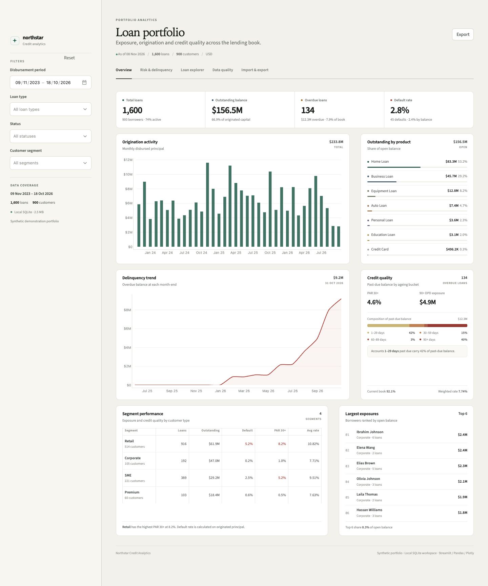

# Northstar documentation

Northstar is a local-first **loan portfolio analytics dashboard** built with Python, Streamlit, Pandas, Plotly and SQLite. It is designed as a clear, practical reference implementation for a lending analytics product: realistic portfolio data, parameterized SQL, interactive risk views, a CSV operating loop, and visible data-quality controls.



---

## What this documentation covers

This documentation is written for three audiences:

- **Product and business reviewers** — what the dashboard shows, who it is for, and where it creates value.
- **Analytics and data teams** — the data model, metric definitions, query layer and quality rules.
- **Engineering and platform teams** — the architecture, operating model, security posture and a practical path from this demo to production.

## Start here

| Document | What you will find |
|---|---|
| [Architecture](architecture.md) | Component map, request lifecycle, module ownership, caching, deployment options and scaling path |
| [Data model](data-model.md) | Schema, field dictionary, relationships, lifecycle states, snapshot generation and data contracts |
| [Metrics and analytics](metrics.md) | Every KPI formula, denominator convention, query catalogue and interpretation caveats |
| [User guide](user-guide.md) | Tab-by-tab walkthrough, filter semantics, import/export workflows and operating notes |
| [Implementation guide](implementation-guide.md) | Use cases, practical implementation opportunities, integration patterns, phased rollout and production roadmap |
| [Operations](operations.md) | Local setup, configuration, backups, runbook, security posture, testing and troubleshooting |
| [Glossary](glossary.md) | Definitions for DPD, PAR, ECL, snapshots, exposure and other terms used throughout the project |
| [Brand guide](brand.md) | Logo system, palette, typography, asset index and usage rules |

---

## Product at a glance

| Area | Current implementation |
|---|---|
| Portfolio | 1,600 synthetic loans across 900 customers |
| History | Up to 36 months of origination data; 18 completed month-end snapshots |
| Products | Personal, Home, Auto, Education, Business, Equipment and Credit Card loans |
| Segments | Retail, SME, Corporate and Premium |
| Currencies | USD presentation |
| Persistence | Single-file SQLite database with foreign keys and WAL mode |
| UI | Five-tab Streamlit workspace: Overview, Risk & delinquency, Loan explorer, Data quality, Import & export |
| Filtering | Disbursement period, loan type, status and customer segment; all filters run in SQL |
| Data quality | 15 automated checks plus field-level completeness |
| Data operations | Validated loan CSV import; filtered CSV exports from the dashboard and explorer |
| Testing | 14 automated tests covering the database, analytics, CSV validation and app rendering |

The seeded data is a demonstrator. All values are synthetic and the metrics are illustrative rather than a regulatory capital calculation.

## Capability map

| Capability | Where it is implemented |
|---|---|
| Synthetic customers, loans and month-end snapshots | [`data_generator.py`](../loan_dashboard/data_generator.py), [`init_db.py`](../init_db.py) |
| Relational persistence and initialization | [`database.py`](../loan_dashboard/database.py) |
| Filter-aware portfolio and risk SQL | [`queries.py`](../loan_dashboard/queries.py), `PortfolioFilters` |
| Five-tab product UI and action wiring | [`app.py`](../app.py), [`ui.py`](../loan_dashboard/ui.py) |
| Plotly visualisations | [`charts.py`](../loan_dashboard/charts.py) |
| Quality checks and completeness | [`quality.py`](../loan_dashboard/quality.py) |
| CSV validation, import template and exports | [`csv_io.py`](../loan_dashboard/csv_io.py) |
| Tests and app smoke checks | [`tests/`](../tests) |
| Brand and favicon | [`assets/`](../assets), [`docs/brand.md`](brand.md) |
| Local setup and operations | [Operations](operations.md) |

## Main use cases

1. **Portfolio monitoring** — a single view of exposure, delinquent balances, default rate and origination pace.
2. **Credit-risk review** — DPD distributions, risk-grade default rates, PAR 30/60/90 and completed-vintage performance.
3. **Segment and product strategy** — compare product allocation, segment risk and average rates.
4. **Exposure review** — identify the largest borrower exposures and their current risk indicators.
5. **Data-quality gatekeeping** — make missing values, orphan records and invalid financial values visible before analysis.
6. **Operational CSV workflows** — add or update loan records and export the current analytical view for reporting.
7. **Pilot and training** — demonstrate a lending analytics product with no external services or credentials.

More detail, including adaptation to real lending systems, is in the [implementation guide](implementation-guide.md).

## How it works in one paragraph

On first run, the app ensures that a SQLite database exists and, if required, generates a deterministic synthetic portfolio. The user selects filters in the sidebar. Every analytical view is produced by parameterized SQL over the `loan_details` view and the `portfolio_snapshots` table; Pandas receives the small result sets and Plotly renders them. The same filter object is passed through every tab so portfolio, risk, loan explorer and export views stay consistent. CSV imports are validated first, skipped or normalized row by row, then written in a single transaction with an upsert and a refreshed month-end snapshot. The complete runtime is one Streamlit process and one SQLite file.

## Quick start

```bash
python3 -m venv .venv
source .venv/bin/activate            # Windows: .venv\Scripts\activate
pip install -r requirements.txt
python init_db.py
streamlit run app.py
```

The app runs at <http://localhost:8501> by default. See [Operations](operations.md) for configuration, rebuild flags, backups and troubleshooting.

## What is intentionally out of scope

The demo does not include authentication, role-based permissions, scheduled ingestion, payment-level history, collections workflows, IFRS 9/ECL provisioning, regulatory reporting, multi-currency FX or a distributed data warehouse. Those gaps and their practical paths forward are documented explicitly in the [implementation guide](implementation-guide.md#4-production-readiness-gaps) and [Operations](operations.md#9-security-posture).

## Documentation conventions

- “Open loans” means loans whose `status` is not `Closed`.
- “Defaulted” means `status = 'Defaulted'`; default rate uses the selected denominator explicitly in every definition.
- “As of” means the current loan records unless a metric is explicitly based on month-end snapshots.
- All amounts are USD in the demo.
- Code references use paths relative to the repository root.

## Source map

| Path | Responsibility |
|---|---|
| [`app.py`](../app.py) | Page composition, filters, tab layouts and action wiring |
| [`loan_dashboard/config.py`](../loan_dashboard/config.py) | Paths, allowed values, colours and chart configuration |
| [`loan_dashboard/data_generator.py`](../loan_dashboard/data_generator.py) | Seeded customer, loan and snapshot generation |
| [`loan_dashboard/database.py`](../loan_dashboard/database.py) | Schema, connections, initialization, upserts and exports |
| [`loan_dashboard/queries.py`](../loan_dashboard/queries.py) | SQL analytics and filter construction |
| [`loan_dashboard/quality.py`](../loan_dashboard/quality.py) | Automated quality and completeness checks |
| [`loan_dashboard/csv_io.py`](../loan_dashboard/csv_io.py) | CSV validation, templates and byte exports |
| [`loan_dashboard/charts.py`](../loan_dashboard/charts.py) | Plotly chart builders |
| [`loan_dashboard/ui.py`](../loan_dashboard/ui.py) | Visual system, layout components and presentation helpers |
| [`init_db.py`](../init_db.py) | Database initialization and sample-data CLI |
| [`tests/`](../tests) | Database, analytics, CSV, quality, brand and app smoke tests |
| [`assets/`](../assets) | Logo system, favicon and typeface licences |

## Maintenance rule

Documentation is part of the product contract. When a schema field, metric definition, filter, CSV rule, quality control or deployment assumption changes:

1. update the affected document in this folder;
2. update the root README if the change affects setup, capabilities or screenshots;
3. run the test suite;
4. add a note to the commit describing the document and code change together.

Metrics remain ambiguous when they are not maintained alongside their definitions. Treat this folder as the canonical explanation of what the dashboard means, not as optional after-the-fact prose.
