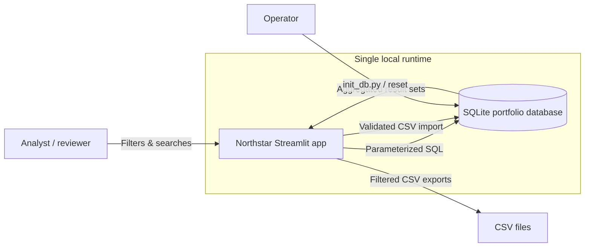
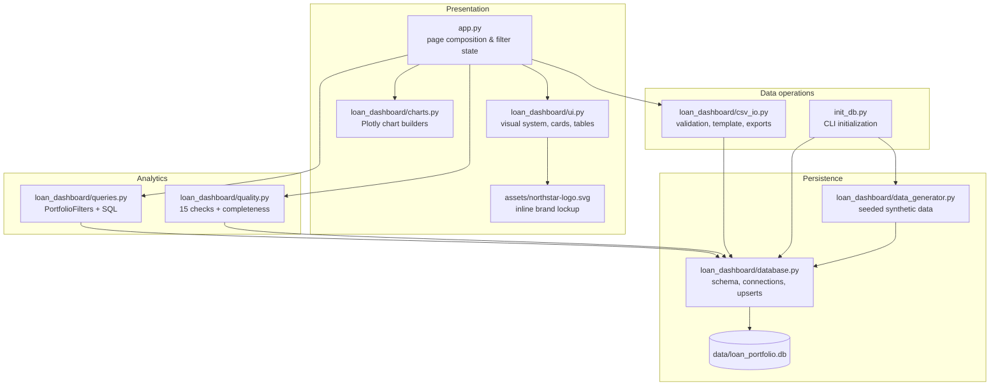
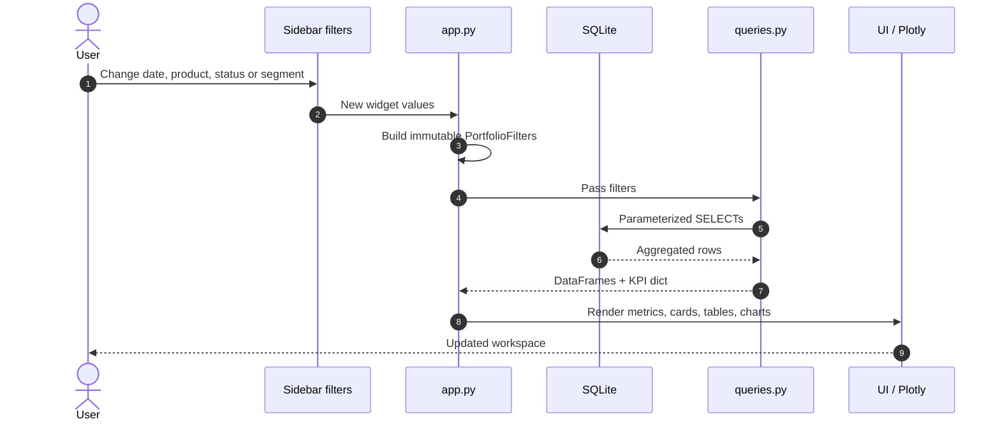
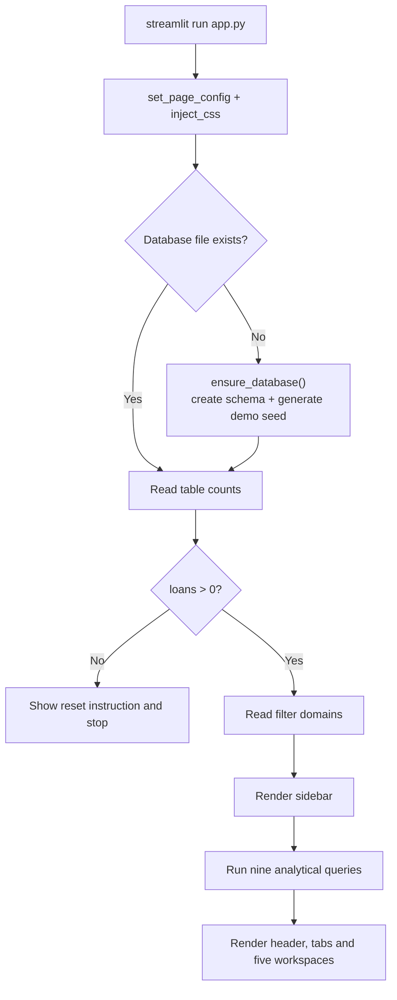
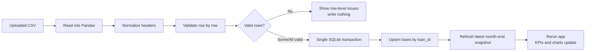
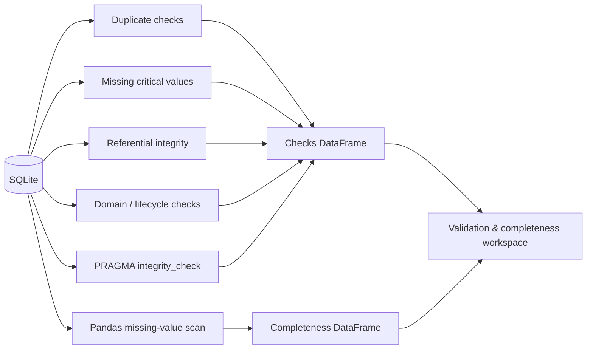
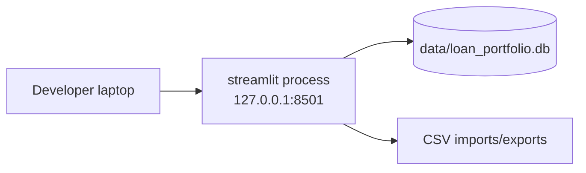
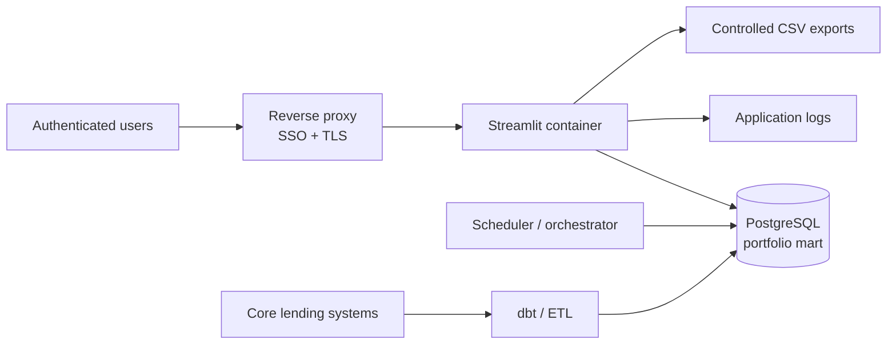

# Architecture

Northstar is a deliberately small, end-to-end analytics application. It favours a visible data path, simple deployment and readable SQL over an abstraction-heavy stack.

The current architecture has three layers:

1. **Presentation** — Streamlit composition, custom UI components and Plotly charts.
2. **Analytics** — a filter-aware, parameterized SQL query layer.
3. **Persistence** — SQLite tables for the customer/loan book and historical month-end snapshots.

There are **no external services** in the demo. The app, database and data-generation logic run locally.

---

## System context



There is no API gateway, background worker, warehouse or scheduled job in the current build. Those are deliberate productionisation extension points, not missing runtime dependencies.

---

## Component map



## Module responsibilities

| Module | Responsibility | Does not do |
|---|---|---|
| [`app.py`](../app.py) | Boots the database, renders the page header and tabs, owns the sidebar filter state, calls queries, wires CSV actions | No business aggregation beyond presentation-level formatting |
| [`loan_dashboard/config.py`](../loan_dashboard/config.py) | Filesystem paths, supported domains, chart config, brand palette | No runtime state |
| [`loan_dashboard/data_generator.py`](../loan_dashboard/data_generator.py) | Deterministic synthetic customers, loans and monthly snapshots | No database writes |
| [`loan_dashboard/database.py`](../loan_dashboard/database.py) | SQLite schema, connections, schema initialization, loan upserts, sample exports | No dashboard queries or UI |
| [`loan_dashboard/queries.py`](../loan_dashboard/queries.py) | Immutable filter object, parameterized WHERE clauses and all analytical SQL | No chart drawing or HTML |
| [`loan_dashboard/quality.py`](../loan_dashboard/quality.py) | Integrity checks and field-level completeness over the full database | Does not repair data |
| [`loan_dashboard/csv_io.py`](../loan_dashboard/csv_io.py) | CSV parsing, validation, normalization, import templates and CSV bytes | Does not decide whether to import; that belongs to the app |
| [`loan_dashboard/charts.py`](../loan_dashboard/charts.py) | Plotly figures with a shared visual language | No SQL or Streamlit state |
| [`loan_dashboard/ui.py`](../loan_dashboard/ui.py) | Custom CSS, brand lockup, metric rail, cards, static tables, quality lists | No data access |
| [`init_db.py`](../init_db.py) | One-command database creation/reset and sample-file export | No app serving |

This division keeps SQL visible and testable while preventing the Streamlit file from becoming a single 2,000-line script.

---

## Request lifecycle

Streamlit reruns the application script from top to bottom when the user changes a widget. There is no separate frontend/backend request boundary.



### Boot path



The database initialization is guarded by `@st.cache_resource` so all browser sessions reuse one bootstrap result. Live row counts are read on each rerun so imports immediately update the sidebar and database snapshot.

---

## Filtering architecture

The shared filter contract is defined as a frozen dataclass:

```python
@dataclass(frozen=True)
class PortfolioFilters:
    start_date: date | None
    end_date: date | None
    loan_types: tuple[str, ...]
    statuses: tuple[str, ...]
    segments: tuple[str, ...]
```

The UI passes the same object to every query, so two cards in the same view cannot silently use different populations.

The filter-to-SQL builder:

- filters `disbursement_date` inclusively between the selected dates;
- uses `IN (...)` for loan type, status and segment;
- treats an empty tuple as no restriction (the UI labels this as “All”);
- adds only fixed, allow-listed column references;
- passes every value as a bound SQLite parameter;
- reads customer attributes through the `loan_details` view.

```sql
FROM loan_details AS d
WHERE d.disbursement_date >= ?
  AND d.disbursement_date <= ?
  AND d.loan_type IN (?, ?)
  AND d.status IN (?)
  AND d.segment IN (?)
```

### Important scope semantics

- The date filter applies to **loan disbursement date**, not to the date a snapshot was taken or a payment occurred.
- The status filter uses the **current loan status**, including in historical overdue-trend queries. A loan that is currently defaulted is filtered as defaulted across its snapshot history when the defaulted status is selected.
- Customer segment filters join through the customer master, so a customer’s current segment applies to all of their historical loans.
- Data-quality checks are intentionally **not filtered**. They audit the complete database.

---

## Analytics layer

`queries.py` owns aggregation and financial calculations. A typical query reads from `loan_details` or joins snapshots to it.

| Function | Primary output | Used by |
|---|---|---|
| `get_filter_options` | Min/max dates and domain counts | Sidebar |
| `get_kpis` | Count, balance, overdue, default rates, PAR, weighted rate, avg DPD | Header and metric rails |
| `get_monthly_originations` | Monthly disbursement and default counts | Overview chart |
| `get_portfolio_mix` | Product-level balance, default count and share | Allocation panel |
| `get_status_mix` | Status split for future reporting | Available query |
| `get_overdue_trend` | Month-end total, overdue and PAR 30 balances | Delinquency chart |
| `get_dpd_buckets` | Open-loan distribution by DPD bucket | Risk distribution and credit-quality panel |
| `get_segment_performance` | Exposure, overdue, default, PAR and rates by segment | Segment cards |
| `get_risk_grade_performance` | Default and delinquency by grade | Risk-grade chart |
| `get_quarterly_vintage` | Origination quarter and default rate | Completed-vintage chart |
| `get_top_exposures` | Largest borrowers by open balance | Exposure panel |
| `get_loans_table` | Loan-level detail for search/export | Loan explorer and exports |
| `get_snapshot_dates` | Snapshot coverage helper | Available utility |

Metrics are defined in detail in [Metrics and analytics](metrics.md).

### Why not calculate in Pandas?

The aggregation is deliberately SQL-based:

- the filtering and grain are explicit;
- the same logic is independently testable with SQLite;
- the app can replace the presentation layer without reimplementing formulas;
- it keeps memory usage bounded to the aggregated result set.

Pandas is used after the query for presentation concerns such as formatting, completion of missing months and chart-ready transformations.

---

## Persistence architecture

SQLite is used as an embedded, zero-configuration analytical store.

| Concern | Implementation |
|---|---|
| Connection | One short-lived connection per function call via `get_connection()` |
| Foreign keys | Enforced with `PRAGMA foreign_keys = ON` |
| Concurrency | WAL mode enabled; suitable for a small local / single-server workload |
| Dates | ISO `YYYY-MM-DD` text, which sorts correctly in SQLite date functions |
| Derived data | A `loan_details` view joins customer attributes to loans |
| Schema creation | `SCHEMA_SQL` is idempotent for the base tables and indexes |
| Analytical result | `pd.read_sql_query` creates DataFrames |
| Import writes | One transaction around the upsert batch and refreshed snapshot |
| Sample exports | `export_sample_files()` writes CSV copies from the live DB |

The database file is configured through `LOAN_DB_PATH`, defaulting to [`data/loan_portfolio.db`](../data/loan_portfolio.db).

### Snapshot design

`portfolio_snapshots` stores one row per loan per completed month-end:

```text
portfolio_snapshots(snapshot_date, loan_id, outstanding_balance, days_past_due, status)
```

The generator estimates the amortized balance at each month-end and records DPD/status as of that point. This provides a stable historical trend independently of today’s current loan record.

Snapshots are only generated for loans inside their active lifetime: a loan is included after disbursement and excluded after its `closed_date`. This keeps the series from backfilling loans that did not exist yet.

The current UI reads the last 18 completed snapshots; the latest one is displayed in the delinquency-trend card.

**Import caveat:** an imported loan receives only a snapshot for the latest completed month-end. The demo does not reconstruct a full historical snapshot series for new imported loans.

---

## Import architecture

The import path separates validation from persistence:



Key properties:

- Customer references are checked against the existing customer master; this demo does not import customers.
- Bad rows are excluded; valid rows can still be imported.
- Existing `loan_id`s update in place.
- Upserts and snapshot refreshes run in one transaction.
- Header names are trimmed and lowercased before matching.
- The largest upload is limited to 20 MB by the Streamlit uploader.
- The write does not require a manual cache clear because analytical queries are intentionally not cached.

The full import contract is in [Data model → CSV contract](data-model.md#csv-contract) and [User guide](user-guide.md#import-loans).

---

## Data-quality architecture

The quality layer performs two different kinds of checks:

1. **Record-level controls** — duplicate identifiers, missing critical fields, orphan relationships, invalid numeric ranges, invalid categorical values, future disbursements, inconsistent lifecycle states, snapshot validity and a SQLite integrity check.
2. **Field-level completeness** — a null/blank scan across all columns, with critical fields flagged using `CRITICAL_COLUMNS`.



The checks are read-only. They identify problems but never silently repair records. The completeness mapping is in [`quality.py`](../loan_dashboard/quality.py).

---

## State, caching and performance

### Streamlit state

| State | Where it lives | Lifetime |
|---|---|---|
| Sidebar selections | `st.session_state` keys (`filter_dates`, `filter_loan_types`, `filter_statuses`, `filter_segments`) | Browser session |
| Explorer search | `st.session_state["explorer_search"]` | Browser session |
| Import success summary | `st.session_state["import_summary"]` | Until “Import another file” |
| Database bootstrap | `@st.cache_resource` | Process lifetime |
| Brand SVG | `@lru_cache(maxsize=1)` | Process lifetime |
| Analytical results | No cache; queried per rerun | One rerun |

The lack of analytical caching is intentional for a local dataset of this size: imports are immediately visible and there is no invalidation logic to reason about. For a warehouse-backed deployment, add TTL or data-version-keyed caching.

### Runtime cost

Every app rerun currently executes the analytical queries and the full quality scan, because Streamlit evaluates all tab bodies even when a tab is not visible. At the demo scale — 21,972 rows across customers, loans and snapshots — this is fast and acceptable.

At production scale, likely optimizations are:

- cache query results by filter and data version;
- lazy-load tabs with `st.fragment` or split pages;
- pre-aggregate core metrics in dbt / warehouse tables;
- run data-quality checks on a schedule and store the result;
- paginate or push loan-level browsing to a dedicated API.

### Responsive layout

The custom CSS stacks analytical columns below 1,100 px and converts the metric rail to a 2×2 grid below 900 px. The sidebar starts collapsed on smaller screens and a fixed chevron control restores it. Charts use Plotly's responsive config.

---

## Deployment topologies

### Current local topology



This topology is intentionally minimal. It is appropriate for demos, analyst workstations, supervised pilots and offline development.

### Reference pilot topology



In a pilot, replace SQLite with a governed database, move data preparation into a scheduled pipeline, put the UI behind SSO and restrict import/export to named roles. The SQL analytics need modest dialect changes when moving to PostgreSQL, and more for BigQuery/Snowflake.

### Production topology considerations

A production lending analytics product should separate:

- ingestion and data contracts;
- transformation and metric definitions;
- serving database / semantic layer;
- UI and API access;
- authentication, authorization and audit;
- monitoring, alerting and lineage.

The current codebase is a compact reference for the calculation and UX layers; it is not a production data platform.

---

## Design decisions and trade-offs

| Decision | Why | Trade-off |
|---|---|---|
| SQLite instead of a warehouse | Zero configuration, portable, easy to inspect and reset | Limited concurrency, no row-level security or distributed storage |
| Raw SQL instead of an ORM | Keeps analytical formulas visible and auditable | More manual query maintenance, dialect lock-in |
| Streamlit instead of a custom SPA | Fastest path to a polished, data-dense internal tool | Limited fine-grained state/access control; every rerun replays the page |
| Snapshot table instead of payment history | Supports required trend views with a simple relational model | No collections, repayment or cash-flow analytics |
| CSV import instead of a write API | Keeps the demo operational without a service boundary | Not suitable for high-volume or real-time data entry |
| Synthetic generator | Reproducible, no sensitive data, offline | Needs a deliberate mapping exercise for real systems |
| Static custom HTML tables/lists | Better typography and alignment than default grids for small aggregate tables | Not sortable; the explorer remains a proper dataframe |
| Schema and seed in one repo | One-command setup and testability | Production migrations require real migration tooling |

---

## Extension points

The shortest, safest places to extend the product:

| Goal | Change |
|---|---|
| Add a metric | Add a function in `queries.py`, add a test, add a UI component or chart |
| Add a filter | Extend `PortfolioFilters`, the form, `_where_clause`, and tests |
| Add a chart | Add a chart builder in `charts.py`, use a query result, render in `app.py` |
| Add a loan field | Update schema, generator, CSV column contract, import validation and tests |
| Add customer import | New validator + transactional upsert for `customers`; check referential rules |
| Add payments/collections | New tables, new aggregation grain, new tab; snapshots should align to payment events |
| Move to PostgreSQL | Replace connection layer, adapt `strftime`/`printf` SQL, add migrations |
| Add scheduled refresh | External ingestion into `loans`/`portfolio_snapshots`, with data-version cache keys |
| Add access control | Authentication at the proxy/runtime; role-aware import/export and data filtering |

More practical product extensions are organised by impact and readiness in the [implementation guide](implementation-guide.md).

---

## Failure modes and guardrails

- **Missing database on startup** — `ensure_database()` creates schema and seed data automatically.
- **Corrupt or schema-less database** — initialization detects a `sqlite3.DatabaseError` and rebuilds the demo database during initialization. In production, replace this with a fail-closed backup/restore runbook rather than silent recreation.
- **Empty database** — the app stops with a clear reset instruction (`python init_db.py --reset`).
- **No filter matches** — metrics render zeros and chart/card empty states; the page warns the user.
- **Invalid CSV / missing customers** — writes are blocked or invalid rows are skipped and reported; valid rows can still be committed.
- **Large data volume** — not addressed by this demo; see scalability in [Operations](operations.md#10-performance-and-scale).
- **Concurrent writes** — WAL improves read/write behavior but SQLite is not a multi-writer analytics warehouse. Imports should be serialized.

## Related documentation

- [Data model](data-model.md)
- [Metrics and analytics](metrics.md)
- [User guide](user-guide.md)
- [Implementation guide](implementation-guide.md)
- [Operations](operations.md)
