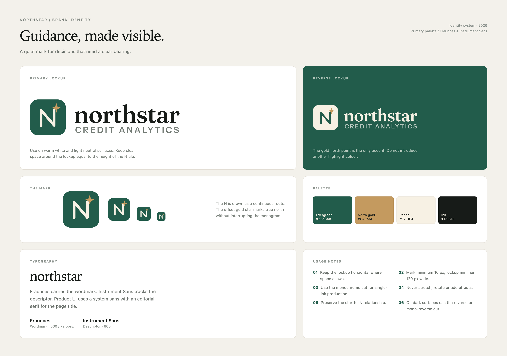

# Northstar brand

> **Guidance, made visible.**  
> A quiet identity for a portfolio analytics product that needs to feel precise, considered and easy to trust.

## The idea

The mark is a monogram, not a decorative sparkle. The **N** is drawn as one continuous route — up, across and back up — and the small gold star sits just beyond its final turn. It reads as a letter, a path and true north at the same time.

The **wordmark** is set in Fraunces, a warm editorial serif with enough character to hold its own beside a spare product interface. The descriptor is set in Instrument Sans at a wide track, giving the lockup a calm, financial-services cadence.

## Logo system

| Asset | Use |
|---|---|
| [`assets/northstar-logo.svg`](../assets/northstar-logo.svg) | Primary lockup on light surfaces |
| `assets/northstar-logo.png` | Transparent raster lockup for docs and slides |
| `assets/northstar-logo-reverse.svg` | Cream lockup on Evergreen or photography |
| `assets/northstar-logo-mono.svg` | One-ink version on light stock |
| `assets/northstar-logo-mono-reverse.svg` | One-ink version on dark stock |
| `assets/northstar-logo-compact.svg` | Mark + wordmark without descriptor |
| `assets/northstar-logo-stacked.svg` | Vertical lockup for narrow or square formats |
| `assets/northstar-mark.svg` | Icon / app mark |
| `assets/northstar-mark-reverse.svg` | Icon on dark surfaces |
| `assets/northstar-mark-mono.svg` | One-ink icon |
| `assets/northstar-mark-mono-reverse.svg` | One-ink icon on dark stock |
| `assets/northstar-favicon.png` | 512 px browser / app icon |
| `assets/northstar-favicon-64.png` | 64 px favicon fallback |
| `assets/northstar-favicon.ico` | Multi-size browser tab icon |

## Palette

| Token | Hex | Use |
|---|---|---|
| Evergreen | `#225C4B` | Brand tile, primary actions, positive emphasis |
| North gold | `#C49A5F` | The single accent: the north point |
| Paper | `#F7F1E4` | Mark letterform, reversed text, light contrast |
| Ink | `#171B18` | Wordmark, primary type |
| Warm canvas | `#F3F1EB` | Product background |
| Hairline | `#E4E1D9` | Rules and card borders |

The gold is intentionally used only once in the mark. Do not add further highlight colours.

## Usage

- Keep the lockup horizontal wherever space allows; use the stacked file for square placements.
- Minimum digital size: **16 px** for the mark, **120 px** wide for the full lockup.
- Keep clear space around the lockup equal to the height of the N tile.
- Use the reverse lockup on Evergreen or dark imagery. Use the monochrome files for one-ink reproduction.
- Do not stretch, rotate, outline, add shadows or gradients to the logo.
- Preserve the relationship between the gold star and the top-right stroke of the N.

## Typography

**Fraunces** (wordmark, 560 weight / 72 optical size) — [SIL Open Font License 1.1](https://github.com/undercasetype/Fraunces).

**Instrument Sans** (descriptor, 600 weight) — [SIL Open Font License 1.1](https://github.com/Instrument/instrument-sans).

The shipped logo files use outlined paths, so the app does not need to load either typeface at runtime. The license texts are included in `assets/licenses/`.

## In the product

The primary lockup is inlined in the filter sidebar so it remains crisp at any display density. The mark is used as the browser favicon. The rest of the product uses a system sans for UI copy and Iowan Old Style for the page title, giving the interface an editorial counterpoint to the serif wordmark.
