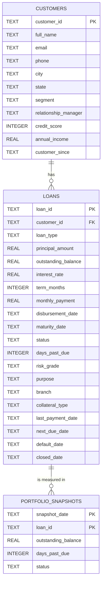

# Data model

The demo uses a normalized SQLite database with three physical tables and one convenience view. The model is intentionally narrow: it supports current-loan analytics and month-end portfolio trends without introducing a payment ledger, collections system or provisioning engine.

- **Database file:** [`data/loan_portfolio.db`](../data/loan_portfolio.db)
- **Schema definition:** [`loan_dashboard/database.py`](../loan_dashboard/database.py)
- **Synthetic generator:** [`loan_dashboard/data_generator.py`](../loan_dashboard/data_generator.py)

All amounts are in USD, and all dates are stored as ISO `YYYY-MM-DD` text.

---

## Entity relationship model



The primary key of `portfolio_snapshots` is the composite key `(snapshot_date, loan_id)`. A loan can therefore have at most one row per completed month-end.

---

## `customers`

Customer master data used for segmentation, credit quality context and filtering.

| Column | Declared type | Required | Meaning |
|---|---|---|---|
| `customer_id` | TEXT | Yes | Primary key, format `CUST-000001` in the demo |
| `full_name` | TEXT | Yes | Customer or borrower display name |
| `email` | TEXT | No | Synthetic contact email |
| `phone` | TEXT | No | Synthetic contact number |
| `city` | TEXT | No | Customer city |
| `state` | TEXT | No | Two-letter US state |
| `segment` | TEXT | Yes | `Retail`, `SME`, `Corporate` or `Premium` |
| `relationship_manager` | TEXT | No | Synthetic relationship owner |
| `credit_score` | INTEGER | Yes | 535–835 range in the generator |
| `annual_income` | REAL | Yes | Synthetic annual income, USD |
| `customer_since` | TEXT | Yes | ISO relationship start date |

In this demo, contact fields are synthetic. A production implementation should treat customer identity and contact data as sensitive and apply masking, retention and access controls.

---

## `loans`

Current-state loan records. This is the primary analytical fact table for current portfolio metrics.

| Column | Declared type | Required | Meaning |
|---|---|---|---|
| `loan_id` | TEXT | Yes | Primary key, format `LN-00001` in the demo |
| `customer_id` | TEXT | Yes | Foreign key to `customers.customer_id` |
| `loan_type` | TEXT | Yes | Product domain: Personal, Home, Auto, Education, Business, Equipment or Credit Card |
| `principal_amount` | REAL | Yes | Original disbursed principal, USD |
| `outstanding_balance` | REAL | Yes | Current outstanding principal, USD |
| `interest_rate` | REAL | Yes | Annual nominal rate in percent (e.g. `8.25` means 8.25%) |
| `term_months` | INTEGER | Yes | Original contractual term in months |
| `monthly_payment` | REAL | Yes | Level amortizing payment, USD |
| `disbursement_date` | TEXT | Yes | Origination date; drives the primary dashboard date filter |
| `maturity_date` | TEXT | Yes | Contractual maturity date |
| `status` | TEXT | Yes | `Active`, `Closed` or `Defaulted` |
| `days_past_due` | INTEGER | Yes | Current days-past-due count |
| `risk_grade` | TEXT | Yes | Internal demo grade `A`–`E` |
| `purpose` | TEXT | No | Product-specific loan purpose |
| `branch` | TEXT | No | Originating branch |
| `collateral_type` | TEXT | No | `Unsecured`, `Property`, `Vehicle`, `Equipment` or `Blanket Lien` |
| `last_payment_date` | TEXT | No | Most recent recorded payment date |
| `next_due_date` | TEXT | No | Next contractual due date, when applicable |
| `default_date` | TEXT | No | Date the loan entered default in the demo |
| `closed_date` | TEXT | No | Date the loan was closed or fully repaid |

### Outstanding balance semantics

The demo models **principal outstanding only**. It does not include:

- accrued interest;
- late fees or penalty interest;
- capitalized arrears;
- recoveries or write-offs;
- undrawn commitments;
- off-balance-sheet exposure.

This is why the application labels the metric “Outstanding balance” rather than “gross carrying amount” or “EAD.”

### Status lifecycle

```text
             ┌─────────────┐
             │   Active    │
             └──────┬──────┘
       repaid or    │     missed payments
       settled      │     / loss event
             ┌──────▼──────┐      ┌────────────┐
             │   Closed    │      │ Defaulted  │
             └─────────────┘      └────────────┘
```

| Status | Expected characteristics | Dashboard treatment |
|---|---|---|
| `Active` | Open balance, not in default; DPD 0–89 in the seeded data | Counted in open loans and risk metrics |
| `Closed` | Outstanding balance zero; `closed_date` populated | Excluded from open balances, PAR and default balance; included in total loan counts and originated principal |
| `Defaulted` | DPD ≥ 90; default date populated; outstanding balance may remain | Included in open balances, overdue loans, PAR and default-rate metrics |

`status` is a simplified demo field, not a regulatory or legal loan classification. A production model would typically use more states (forbearance, restructure, write-off, recovery, etc.) and separate servicing and credit-risk statuses.

---

## `portfolio_snapshots`

Monthly historical balances used by the delinquency-trend view.

| Column | Declared type | Required | Meaning |
|---|---|---|---|
| `snapshot_date` | TEXT | Yes | Composite primary key part, completed month-end date |
| `loan_id` | TEXT | Yes | Composite primary key part, foreign key to `loans` |
| `outstanding_balance` | REAL | Yes | Estimated principal balance at that month-end |
| `days_past_due` | INTEGER | Yes | DPD bucket source at that month-end |
| `status` | TEXT | Yes | Historical status (`Active` or `Defaulted` in generated data) |

The current database has **19,472** snapshot rows across **18** completed month-ends from **31 May 2025** through **31 Oct 2026** in the seeded version.

### Snapshot grain and rules

- Grain: one row per loan per completed month-end.
- A snapshot is included after `disbursement_date`.
- A snapshot is excluded once the loan’s `closed_date` is on or before the snapshot month-end.
- Balances are derived from a standard amortizing-loan schedule.
- The trend query joins the snapshot to `loan_details` so segment and current-loan filters can be applied.
- `portfolio_snapshots.status` can differ from the loan’s current `loans.status`; the dashboard filters currently use the loan’s current status and segment. This is appropriate for a current-portfolio lens, but not for a strict historical point-in-time cohort analysis.

A production implementation would usually generate point-in-time snapshots from servicing events and keep both current and as-of statuses for cohorting.

---

## `loan_details` view

`loan_details` is a one-row-per-loan view that joins the customer attributes needed for filtering and display.

```sql
CREATE VIEW loan_details AS
SELECT
    l.loan_id, l.customer_id, c.full_name, c.segment, c.city, c.state,
    c.credit_score, c.annual_income, c.relationship_manager,
    l.loan_type, l.principal_amount, l.outstanding_balance, l.interest_rate,
    l.term_months, l.monthly_payment, l.disbursement_date, l.maturity_date,
    l.status, l.days_past_due, l.risk_grade, l.purpose, l.branch,
    l.collateral_type, l.last_payment_date, l.next_due_date,
    l.default_date, l.closed_date
FROM loans AS l
JOIN customers AS c ON c.customer_id = l.customer_id;
```

The analytics layer almost always uses this view as `d`. This keeps the segment filter and customer attributes consistent across every query.

---

## Keys, indexes and constraints

| Object | Type | Purpose |
|---|---|---|
| `customers.customer_id` | Primary key | Customer uniqueness |
| `loans.loan_id` | Primary key | Loan uniqueness |
| `portfolio_snapshots(snapshot_date, loan_id)` | Composite primary key | One snapshot per loan per month-end |
| `loans.customer_id` | Foreign key | Referential integrity |
| `portfolio_snapshots.loan_id` | Foreign key, cascade delete | Referential integrity and cleanup |
| `idx_loans_customer` | Index | Customer-to-loan lookups |
| `idx_loans_disbursement` | Index | Date-range filters and origination grouping |
| `idx_loans_type` | Index | Product filters |
| `idx_loans_status` | Index | Status filters |
| `idx_loans_risk` | Index | Risk aggregation |
| `idx_snapshots_date` | Index | Month-end aggregation |

Only a few constraints are enforced by SQLite itself:

- primary keys;
- foreign keys;
- `principal_amount > 0`;
- `outstanding_balance >= 0`.

Domain values, lifecycle consistency and completeness are enforced by the generator, CSV validator and quality layer. A production schema should add lookup tables or database check constraints for domains that are stable at the database level.

---

## Validation domains

### Loan types

- Personal Loan
- Home Loan
- Auto Loan
- Education Loan
- Business Loan
- Equipment Loan
- Credit Card

### Statuses

- Active
- Closed
- Defaulted

### Risk grades

- A
- B
- C
- D
- E

### Customer segments

- Retail
- SME
- Corporate
- Premium

These values are defined in [`config.py`](../loan_dashboard/config.py). Changing them requires coordinated changes to the schema contract, generator, validator, filters and tests.

---

## DPD and delinquency interpretation

Days past due is measured as of the current loan record or the month-end snapshot.

The dashboard uses the following buckets:

| Bucket | Definition |
|---|---|
| Current | `days_past_due = 0` |
| 1–29 days | `1 <= days_past_due <= 29` |
| 30–59 days | `30 <= days_past_due <= 59` |
| 60–89 days | `60 <= days_past_due <= 89` |
| 90+ days | `days_past_due >= 90` |

PAR 30+, PAR 60+ and PAR 90+ refer to outstanding balance in the respective buckets divided by total open outstanding. Defaulted loans are included in these buckets.

### Important lifecycle caveat

The data model uses one `days_past_due` value per loan. It does not contain a full repayment schedule or payment-level arrears ledger. A production model should derive DPD from contract due dates and payment allocation, and retain arrears history rather than a single current integer.

---

## Synthetic data generation

The generator is deterministic for a given seed and as-of date. It is intended to be realistic enough for product evaluation and internal demonstrations, not statistically calibrated to a specific lending portfolio.

### Customers

- 900 customers by default.
- Segment weights: Retail 56%, SME 25%, Corporate 13%, Premium 6%.
- Credit scores are normally distributed around segment-specific means and bounded to 535–835.
- Annual income uses segment-specific lognormal distributions.
- Customer start dates span the last several years.
- City/state pairs and relationship managers are sampled from fixed lists.
- Contact data is synthetic and uses reserved `example.com`-style addresses.

### Loans

- 1,600 loans by default.
- Every customer receives at least one loan; the remaining loans are randomly assigned.
- Product mix depends on the customer segment.
- Principal uses product-specific min/max ranges and a log-uniform draw.
- Interest rate is based on product, credit score, segment and noise, then clamped to product bounds.
- Terms follow product-specific weighted choices.
- Disbursement dates are spread across the prior 36 months.
- Status and DPD are influenced by credit grade, product risk and age.
- Closed loans have zero outstanding and a close date.
- Delinquent active loans have DPD under 90.
- Defaulted loans have DPD above 90, a default date and remaining balance.

### Snapshots

- Generated for the 18 completed month-ends before the current date.
- The generator estimates amortized principal at each month-end.
- Historical DPD is derived from the current delinquency state and default date.
- Closed loans stop appearing after their close date.

At the seeded snapshot used in this repository:

| Metric | Value |
|---|---|
| Customers | 900 |
| Loans | 1,600 |
| Loan principal | ~$233.8M |
| Outstanding principal | ~$156.5M |
| Active loans | 1,185 |
| Closed loans | 370 |
| Defaulted loans | 45 |
| Snapshot rows | 19,472 |
| Completed monthly snapshots | 18 |

Regenerating on a different date changes the dates and therefore the sample values; the seed still keeps the structure and assignment reproducible for that date.

---

## CSV contract

The operational CSV import writes only to `loans`. Customer records must already exist.

### Required columns

```text
loan_id
customer_id
loan_type
principal_amount
interest_rate
term_months
disbursement_date
status
```

### Optional columns

```text
outstanding_balance, maturity_date, monthly_payment, days_past_due,
risk_grade, purpose, branch, collateral_type, last_payment_date,
next_due_date, default_date, closed_date
```

### Defaults and normalization

| Situation | Behaviour |
|---|---|
| Missing/blank `outstanding_balance` | Defaults to `principal_amount` |
| Missing `maturity_date` | Derived using `disbursement_date + term_months` |
| Missing/non-positive `monthly_payment` | Calculated from principal, rate and term |
| Blank `risk_grade` | Defaults to `C` |
| Blank `days_past_due` | Defaults to `0` |
| Blank `purpose` | Becomes `Imported` |
| Blank `branch` | Becomes `Imported` |
| Blank `collateral_type` | Becomes `Unsecured` |
| Active loan without `next_due_date` | Set to current date + 30 days |
| Defaulted loan with DPD under 90 | Adjusted to 90 and reported as an import note |
| Defaulted loan without `default_date` | Set to current date − DPD days |
| Closed loan without `closed_date` | Set to current date with an import note |
| Closed loan with balance > 0.01 | Rejected as invalid |

### Validation rules

- Required headers must exist.
- Header names are trimmed and matched case-insensitively.
- Extra columns are ignored.
- `customer_id` must exist in `customers`.
- Supported loan type, status and risk grade values are required.
- Principal must be positive.
- Outstanding balance must be non-negative.
- Interest rate must be between 0 and 50.
- Term must be an integer between 1 and 600 months.
- Disbursement date is required; optional dates must parse.
- Duplicate `loan_id` values within one upload are rejected after the first occurrence.
- Existing `loan_id` values update the existing loan (upsert).
- Valid rows are imported; invalid rows are skipped and shown in the UI.
- Header and row validation happens before the database transaction.

### Import persistence semantics

- All valid rows are written in a single SQLite transaction.
- New loans receive a snapshot for the latest completed month-end only.
- Existing loans have their latest completed month-end snapshot refreshed.
- Historical snapshot series are not reconstructed for imported loans.
- The import requires no manual cache invalidation because analytical queries are not cached.

A fuller operator walkthrough is in the [User guide](user-guide.md#import-loans).

---

## Data file artifacts

| Artifact | Purpose |
|---|---|
| [`data/loan_portfolio.db`](../data/loan_portfolio.db) | Generated SQLite portfolio database |
| `data/loan_portfolio.db-wal` / `-shm` | SQLite runtime files (ignored by git) |
| [`data/sample/customers_sample.csv`](../data/sample/customers_sample.csv) | Flat customer extract |
| [`data/sample/loans_sample.csv`](../data/sample/loans_sample.csv) | Joined loan/customer extract |
| [`data/sample/portfolio_snapshots_sample.csv`](../data/sample/portfolio_snapshots_sample.csv) | Monthly snapshot extract |
| [`data/sample/import_template.csv`](../data/sample/import_template.csv) | One-row template for the loan import contract |

The sample CSVs are generated by `init_db.py` and are refreshed on `--reset`.

---

## Migration guidance

For a real implementation, transform source systems into a model with clear grains:

- **Loan dimension / fact** — one row per loan, or a slowly changing dimension plus a current fact if attributes change over time.
- **Customer dimension** — one row per customer, with segment and relationship attributes tracked historically if necessary.
- **Scheduled monthly fact** — one row per loan per reporting date, with balances, DPD, status, risk grade and any regulatory stage.
- **Payments** — one row per payment/event if collections, cash flow or recovery analysis is required.
- **Credit-risk staging** — clearly separate DPD, forbearance, restructuring, default and write-off states.

Recommended changes from the demo schema:

1. Use explicit database constraints and lookup tables for stable domains.
2. Add a generated month-end calendar table and a portfolio snapshot job.
3. Replace synthetic `risk_grade` with a governed internal rating model.
4. Add audit timestamps (`created_at`, `updated_at`, `source_system`, `source_batch_id`).
5. Store customer PII separately from analytics attributes and mask it in dashboards.
6. Version metric definitions and document lineage from source to dashboard.
7. Introduce migration tooling (Alembic, dbt, or warehouse-native migrations) before changing production tables.

---

## Related documentation

- [Metrics and analytics](metrics.md)
- [Architecture](architecture.md)
- [User guide](user-guide.md)
- [Operations](operations.md)
