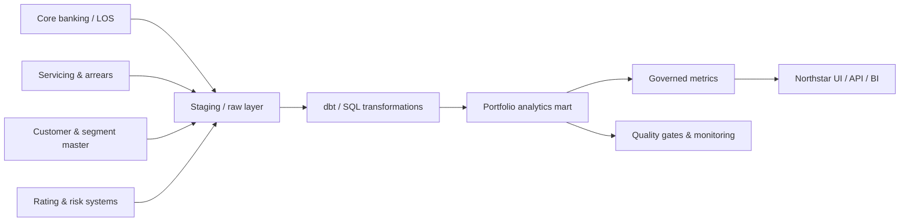

# Implementation guide

This document moves from “the demo works” to “how would we use this in a real lending organisation?” It covers the practical use cases, the changes required for real data, realistic delivery options and the risks that must be managed before the dashboard is used for decisions.

The current application is a **reference implementation and pilot asset**, not a production credit-risk system.

---

## 1. Where the product is useful

The strongest fit is as an **internal portfolio and credit-quality workspace** for a single lending book. It creates value when analysts currently assemble the same monthly view from spreadsheets, manual extracts and repeated SQL queries.

### Primary personas

| Persona | Questions they bring | What Northstar gives them |
|---|---|---|
| Chief Risk Officer / Head of Credit | Where is risk concentrated, and is it improving? | KPI rail, PAR, default, DPD and segment/vintage views |
| Portfolio manager | What changed this month and where? | Origination trend, overdue trend, product and segment mix |
| Credit analyst | Which cohorts, grades or segments are deteriorating? | Risk-grade default, DPD buckets and vintage performance |
| Collections lead | Which loans are materially past due? | DPD distribution and searchable loan-level data |
| Data steward | Can I trust the numbers? | Validation controls, completeness and expected-blank fields |
| Product / strategy lead | Where is capital allocated, and at what rate? | Product allocation, weighted rate and segment performance |
| Lending operator | How do I correct or add a loan record? | Validated CSV upsert with error reporting |
| Leadership / board support | What is the one-page view? | Overview and CSV exports for committee packs |

### Use case fit matrix

| Use case | Fit today | What is already available | What would be needed for production |
|---|---|---|---|
| Monthly portfolio review | Strong | Current-book KPIs, trend, segments, exposure | Real data refresh, definitions sign-off, access control |
| Credit-risk committee pack | Strong | Risk views, segment/vintage breakdowns, CSV exports | Point-in-time snapshots, report templates, audit/versioning |
| Early-warning monitoring | Partial | DPD buckets, defaults, largest exposures | Payment-level history, watchlists, alert rules, workflow |
| Collections prioritisation | Partial | DPD and loan-level search | Contact history, assignment, payment plans, account statuses |
| Product strategy | Good | Product balance share, rates, segment risk | Origination margin, profitability, application funnel |
| Data-quality gatekeeping | Strong | Duplicate, completeness and domain checks | Source-system lineage, scheduled runs, issue ownership |
| Regulatory / IFRS 9 reporting | Not supported | Current exposure and default rates | Staging, ECL, discounting, recoveries, governance and sign-off |
| Customer-facing portal | Not supported | Internal analytical reference | Authentication, data residency, permissions, product-grade service levels |
| White-label demo / proof of concept | Strong | Brand, synthetic data, one-command setup | Branding configuration and demo script |

---

## 2. Practical implementation opportunities

The following opportunities are ordered roughly by value-to-effort for a first implementation.

### 2.1 Replace the spreadsheet monthly pack

**Opportunity:** use the Overview and Risk tabs as the single internal monthly portfolio review.

**Why it fits:** the application already computes the core lending metrics consistently from one data source. The CSV exports can feed committee packs.

**Implementation steps:**

1. Agree the exact KPI definitions and denominators with risk and finance.
2. Map the source extracts to the demo schema.
3. Load one complete historical month plus the latest month-end.
4. Run a reconciliation workshop against the current spreadsheet pack.
5. Sign off as-of dates, filters and the treatment of closed/defaulted loans.
6. Deploy the app internally behind a password or SSO proxy.
7. Set a monthly refresh and an owner for data-quality exceptions.

**Effort:** low to medium. **Dependency:** stable source extract and metric sign-off.

### 2.2 Build a credit-quality early-warning surface

**Opportunity:** combine the current DPD views with a watch-list of accounts approaching a risk threshold.

**What the demo already supports:**

- DPD bucket distribution;
- PAR 30/60/90 metrics;
- segment and grade default rates;
- largest exposures and maximum DPD.

**What to add:**

- days since last payment (from a payment ledger);
- missed-payment counts and cure rates;
- limit utilisation and utilisation trend;
- watch-list flags and ownership;
- month-over-month deterioration logic;
- alert delivery and workflow notes.

**Effort:** medium to high because it depends on payment-level data and a decisioning workflow, not just a chart.

**Important:** avoid hard-coding “alert” thresholds into presentation logic. Keep thresholds in configuration, version them and document who approved them.

### 2.3 Give collections a focused work queue

**Opportunity:** turn the loan explorer into a filtered portfolio review / collections queue.

**Baseline:**

- filter by DPD, segment and product;
- export the filtered set;
- show exposure and grade.

**Extension:**

- assign the queue to a collections officer;
- add payment promise dates and contact history;
- include cure probability or expected recovery;
- enforce visibility by role and region;
- record queue actions and outcomes for audit.

The current app is **read-only** with respect to collections. It should not be presented as an operational collections system until workflow, access and audit controls are implemented.

### 2.4 Use data quality as a release gate

**Opportunity:** run the quality check suite before data enters a reporting mart.

**Practical pattern:**

1. Load a staging table.
2. Run the same validation rules as the CSV importer and quality module.
3. Block or quarantine the load if critical checks fail.
4. Publish a quality score and exception report.
5. Keep the dashboard read-only.
6. Route exceptions to the data owner with deadlines.

This is a low-risk adoption path because the app does not need to write into a core system. It makes data integrity visible without asking users to trust a new operational platform immediately.

### 2.5 Provide a shared metric prototype

**Opportunity:** use the SQL query layer as a specification for a production semantic layer.

Move the definitions into dbt, a metrics layer, or warehouse views once they are agreed. The current query implementations are deliberately explicit, which makes them useful for definition reviews.

Recommended handoff artifacts:

- metric name and plain-language definition;
- numerator, denominator and exclusions;
- as-of logic;
- treatment of closed, defaulted, restructured and written-off accounts;
- intended audience and decision;
- test cases with expected results.

### 2.6 Support stress-testing and scenario analysis

**Opportunity:** extend current metrics with scenarios such as a rise in DPD migration or a segment-specific default shock.

This is **not supported today**. A credible stress view needs:

- an explicit baseline cohort and as-of date;
- migration assumptions;
- PD/LGD/EAD or simplified loss assumptions;
- forecast horizons;
- scenario governance and versioning.

The current dashboard can display the baseline; it should not be described as a stress-test engine.

### 2.7 Track vintage and acquisition quality

**Opportunity:** compare underwriting quality across origination cohorts.

The current vintage chart shows observed default rate by completed disbursement quarter. A production version should use:

- months-on-book columns;
- cumulative default curves;
- cohort/state transitions;
- product/segment adjustment;
- vintage tables that separate acquisition and performance changes.

### 2.8 Embed a diagnostic or demo in a sales/partner workflow

**Opportunity:** use the synthetic data and brand system as a repeatable product demo.

Practical options:

- local demo on a laptop during a workshop;
- hosted read-only demo on a private URL;
- white-label package with a customer name and logo;
- data allow-listing for prospective customers who bring a small anonymised extract.

Requirements for a hosted demo: authentication, rate limiting, a disclosure banner, synthetic-data labelling and a cleanup schedule.

---

## 3. Path from demo to real data

The demo database makes assumptions that should be replaced deliberately, not silently.

### 3.1 Source mapping

| Demo field | Likely source | Mapping notes |
|---|---|---|
| `customer_id` | Customer master / CRM / party reference | Create a stable cross-system identifier; never use an email address as the key |
| `full_name` | Customer master | PII; separate from analytics attributes and mask where possible |
| `segment` | Customer segmentation model or business rule | Define treatment for missing and changed segments |
| `credit_score` | Credit bureau / internal score | Store score source, date, model version and scale |
| `loan_id` | Loan management / core banking system | Add source-system prefix to avoid collisions |
| `loan_type` | Product master | Governed product hierarchy, not raw free-text product names |
| `principal_amount` | Origination/servicing system | Clarify disbursed vs sanctioned vs undrawn |
| `outstanding_balance` | Servicing month-end extract | Clarify principal vs carrying amount vs total exposure |
| `interest_rate` | Contract / loan master | Define fixed vs floating, nominal vs effective |
| `disbursement_date` | Origination system | Use the actual value date, not application date |
| `status` | Servicing / risk classification | Map many source statuses into the reporting taxonomy deliberately |
| `days_past_due` | Arrears engine / servicing system | Derive from contractual dues and payments; define cure rules |
| `risk_grade` | Internal rating model | Store rating scale, model version and as-of date |
| `purpose` | Origination system | Normalise product-specific values |
| `collateral_type` | Collateral register | Do not infer collateral from product alone |
| `portfolio_snapshots` | Warehouse monthly snapshot job | Must be point-in-time and reproducible |

### 3.2 Data quality questions to answer

Before using the dashboard for decisions, agree:

- Which date determines the reporting period: disbursement, balance snapshot, due date or accounting date?
- Does “outstanding” mean principal only, carrying value, drawn amount or total exposure?
- How are restructured, forborne and written-off accounts represented?
- What is the definition of default, and when does a loan leave default?
- Are customers joined on a stable legal entity or a product-level party ID?
- How are transferred, refinanced and topped-up loans treated?
- Is a loan counted once when multiple facilities belong to the same borrower?
- What is the source of truth for segment and risk grade, and how are changes handled historically?
- What are the approved currency and FX translation policies?

### 3.3 Reference ingestion flow

Keep the raw layer immutable where possible. Build the current-loan table and the point-in-time snapshot table from source events rather than overwriting history.

### 3.4 Minimum production data model changes

- Replace SQLite with a governed database when multiple users or scheduled writes are involved.
- Add `source_system`, `source_record_id`, `loaded_at` and `data_as_of` fields.
- Add a proper payment/repayment event table before claiming collection or cash-flow analytics.
- Add a calendar or reporting-date dimension.
- Version risk grades, segments and product mappings if they can change.
- Separate PII from analytical attributes and implement masking.
- Add migrations and schema contracts.
- Add auditable data-quality results with run IDs.

---

## 4. Production-readiness gaps

This is the honest gap analysis for the current demo.

| Gap | Current state | Required for production | Relative effort |
|---|---|---|---|
| Authentication and SSO | None | Identity-aware proxy or app auth with SSO, MFA and session policy | S–M |
| Role-based authorization | None | Restrict import/export and portfolio scope by role | M |
| Sensitive data controls | Synthetic data only | PII minimisation, encryption, masking, retention, access logging | M–L |
| Real data ingestion | CSV only | Scheduled, observable, tested ingestion pipeline | M–L |
| Data model depth | No payments or recoveries | Event-level servicing and recovery model | L |
| Point-in-time snapshots | Synthetic month-end estimates | Reproducible monthly snapshot job with lineage | M–L |
| Metric governance | Documented in code and docs | Formal definitions, ownership and sign-off | S–M |
| Warehouse / concurrency | Single SQLite file | Managed relational/warehouse platform | M |
| Query performance | Uncached per-rerun queries | Caching, pre-aggregation, indexed warehouse | M |
| Observability | UI errors only | Pipeline/app logs, metrics, alerting and data SLA | M |
| Audit | None | Immutable logs for access, exports and imports | M |
| Automated tests on real data | Synthetic unit/smoke tests | Data contracts, reconciliation tests, CI/CD | M–L |
| Recovery/backups | Manual copy | Automated backup, restore drills, RPO/RTO | M |
| Regulatory reporting | Not supported | Staging, ECL, reconciliation, approvals and audit trail | XL |

**Key:** S = small, M = medium, L = large, XL = very large relative to the demo. These are for planning discussions, not delivery commitments.

### Never do this without controls

- Expose the current Streamlit server directly to the public internet.
- Import customer or loan data you are not authorised to process.
- Use unapproved KPI definitions for external or regulatory reporting.
- Treat synthetic trends as evidence about a real portfolio.
- Run automated data deletion or schema replacement against a production database.
- Present model/risk outputs without documenting assumptions and ownership.

---

## 5. Phased implementation plan

The roadmap below is a practical path for an internal pilot. Timelines are indicative and assume access to source data and a decision owner.

### Phase 0 — Demo and discovery (current state)

**Goal:** align on the user problem and the metric language.

- Run the synthetic dashboard.
- Walk through the five tabs with risk, analytics and data owners.
- Agree the first user group and the first decision the dashboard should support.
- Choose one initial scope (e.g. one product line or region).

**Exit criteria:** a named product owner, a defined first decision, a prioritized metric set, and an agreed source-data contact.

### Phase 1 — Data proof (2–4 weeks)

**Goal:** replace synthetic data with a stable, reconciled extract.

- Map source fields to the schema.
- Load a historical and current extract into a staging environment.
- Reconcile totals to an existing report.
- Sign off definition gaps and exclusions.
- Create a repeatable snapshot job.
- Keep access limited to the working group.

**Exit criteria:** portfolio totals reconcile; metric definitions are signed off; the build has a reproducible refresh.

### Phase 2 — Controlled pilot (3–6 weeks)

**Goal:** put the dashboard in front of a small internal group.

- Deploy behind SSO/VPN.
- Move from SQLite to a managed serving database or expose governed views.
- Add basic access roles and audit for imports/exports.
- Add data-quality gates and dashboard status.
- Set a refresh schedule and an escalation owner.
- Capture feedback on the questions the tool cannot answer.

**Exit criteria:** regular use by the pilot group, no unexplained metric reconciliations, documented support owner and acceptable refresh latency.

### Phase 3 — Production hardening (6–12+ weeks)

**Goal:** make the tool dependable and supportable.

- Formal CI/CD, migrations and test coverage.
- Monitoring, alerting and a runbook for failed refreshes.
- Access review, retention and PII controls.
- Backup/restore and disaster-recovery drills.
- Performance work and caching at the required data volume.
- Approved reporting definitions and audit trail.

**Exit criteria:** service ownership, SLOs and incident process agreed; audit and security reviews complete; users no longer rely on manual shadow reports.

### Phase 4 — Differentiated analytics

Only after the core is trusted:

- collections prioritisation and workflow;
- early-warning scores;
- vintage curves by months-on-book;
- scenario/stress analysis;
- IFRS 9 / ECL integration;
- segment profitability and pricing analytics;
- embedded partner reporting.

---

## 6. Practical delivery options

### Option A — Local analyst tool

**Shape:** analyst workstation, read-only, refreshed from a monthly extract.

**Best for:** one or two analysts, rapid prototyping, workshops.

**Changes needed:** replace CSV/demo data with a governed extract, set a file location and access policy, document refresh steps.

**Trade-offs:** no central permissions, no shared audit, data can go stale silently, not suitable for broad distribution.

### Option B — Internal Streamlit pilot

**Shape:** one Streamlit server, SSO proxy, read-only for most users, restricted CSV admin.

**Best for:** an internal dashboard pilot with 5–50 users.

**Changes needed:** authentication, managed database or snapshot service, deployment automation, logging, backups, import restricted to a named role.

**Trade-offs:** Streamlit remains a single-process UI; high traffic or complex interactions may require a different front end.

### Option C — Analytics-platform front end

**Shape:** governed warehouse with dbt metrics; Streamlit or a dedicated web app as a serving layer.

**Best for:** multiple teams, many data sources, formal metric governance.

**Changes needed:** data platform, lineage, data contracts, orchestration, cataloguing, access control, service ownership.

**Trade-offs:** significantly more cost and governance complexity; slower initial delivery; stronger long-term foundation.

### Option D — Embedded diagnostic / product demo

**Shape:** branded, read-only, hosted or customer-provided data, time-limited.

**Best for:** sales engineering, partner workshops, product validation.

**Changes needed:** authentication, tenant isolation, synthetic-mode banner, deletion schedule and branding configuration.

**Trade-offs:** not a substitute for a production customer platform and still requires security controls.

---

## 7. Success measures for the implementation

Measure adoption and decision value, not just page visits.

| Measure | Why it matters |
|---|---|
| Portfolio reconciliation accuracy | The dashboard must agree with the source of truth before adoption |
| Time to produce the monthly portfolio pack | Direct productivity value |
| Number of manual spreadsheet variants retired | Reduction in metric fragmentation |
| Data-quality findings caught before reporting | Improvement in trust and timeliness |
| Active users by role | Indicates whether the right personas are engaged |
| Time to answer a risk question | Operational usefulness |
| Filtered views/exports used in decisions | Evidence of decision support |
| Incidents or metric-definition disputes | Governance health |

A dashboard that is visited daily but not used in decisions is not yet a successful product.

---

## 8. Risks and mitigations

| Risk | Impact | Mitigation |
|---|---|---|
| Metric definitions drift from finance/risk definitions | Loss of trust; conflicting numbers | Written metric catalogue, owner sign-off, regression tests |
| Stale data is mistaken for current data | Bad decisions | Prominent data-as-of and refresh status; freshness checks |
| PII leaks through exports or screenshots | Compliance and reputational harm | Masking, role-based export controls, DLP and audit |
| Synthetic patterns are over-interpreted | Misinformed decisions | Synthetic-data banner, demo-only disclaimers and training |
| SQLite / Streamlit load limits reached | Slow or unavailable dashboards | Move to managed DB, pre-aggregate, cache, load test |
| Scope expands into collections/ECL prematurely | Delivery risk and unclear ownership | Phased roadmap and explicit non-goals |
| Source data quality unknown | Misleading portfolio metrics | Quality gates, source ownership and reconciliation |
| Import privileges are too broad | Corrupted data | Admin-only import, validation, audit and backups |
| Point-in-time snapshots not reproducible | Audit and analytic gaps | Snapshot job with run IDs, lineage and locked source extracts |
| Vendor lock-in | Higher cost / limited flexibility | Keep metrics in documented SQL and use standard data formats |

---

## 9. Recommended first pilot

For the safest high-value start, scope the first pilot to a **monthly portfolio review for one product or region** with **read-only access**.

**Included:**

- Overview and Risk tabs;
- current and one prior month-end snapshot;
- four agreed metrics: outstanding, overdue balance, PAR 30+, balance-based default rate;
- segment table;
- one controlled CSV export;
- SSO-protected internal access.

**Explicitly excluded from the first pilot:**

- direct writes to core systems;
- collections workflow;
- regulatory or IFRS 9 reporting;
- public access;
- complex scenario analysis.

**Exit decision:** if the pilot cannot reconcile to the existing report or cannot name a regular user, do not proceed to a wider rollout until those gaps are resolved.

---

## 10. Summary

Northstar is strongest as a **clear, maintainable portfolio analytics reference** and a **practical internal pilot**. Its data model and presentation are deliberately transparent enough to support a definition workshop, while the current architecture keeps the cost of experimentation low.

The path to production is not primarily a UI problem. It is a data-governance, security and reliability programme:

1. make definitions and source contracts explicit;
2. make refreshes and snapshots reproducible;
3. make access and exports controlled;
4. make failures observable;
5. only then expand into operational and regulatory use cases.

## Related documentation

- [Architecture](architecture.md)
- [Data model](data-model.md)
- [Metrics and analytics](metrics.md)
- [Operations](operations.md)
- [User guide](user-guide.md)
