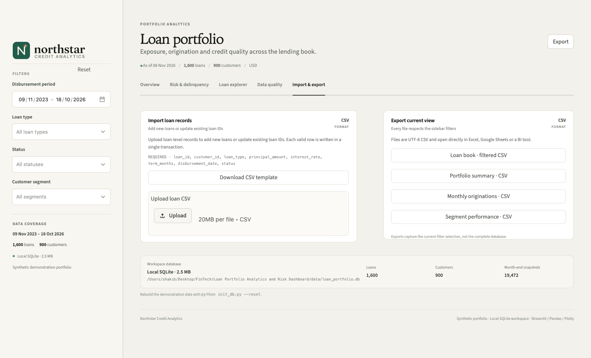

# Operations

This is the operator runbook for the local Northstar demo: setup, configuration, refreshes, backups, validation, troubleshooting and the controls that must be added before using the app with real data.



---

## 1. Environment

| Requirement | Value |
|---|---|
| Python | 3.11+ recommended; project is tested on 3.11 |
| SQLite | Bundled with Python; no server or service |
| Required packages | See [`requirements.txt`](../requirements.txt) |
| Runtime | One Streamlit process |
| Default port | 8501 |
| Default database | [`data/loan_portfolio.db`](../data/loan_portfolio.db) |
| Currency in demo | USD |
| External services | None |

`requirements.txt` pins Streamlit 1.67.0 and allows compatible Pandas 2.x and Plotly 6.x releases. The current development environment uses Pandas 2.3.3 and Plotly 6.9.0.

---

## 2. Install and run

```bash
cd "Loan Portfolio Analytics and Risk Dashboard"
python3 -m venv .venv
source .venv/bin/activate              # Windows: .venv\Scripts\activate
pip install -r requirements.txt

python init_db.py                      # create the demo database + sample CSVs
streamlit run app.py
```

Open the URL printed by Streamlit, normally:

```text
http://localhost:8501
```

`streamlit run` also works without `init_db.py`: the app auto-creates the database on first launch, but it will not write the sample CSV exports.

### Run against another database

```bash
LOAN_DB_PATH=/absolute/path/portfolio.db streamlit run app.py
```

`LOAN_DB_PATH` is read by [`config.py`](../loan_dashboard/config.py). The parent directory is created automatically when a connection is opened.

### Run on a different port

```bash
streamlit run app.py --server.port 8502
```

For a server deployment, keep the app bound to loopback and place it behind an authenticated reverse proxy:

```bash
streamlit run app.py --server.address 127.0.0.1 --server.port 8501
```

---

## 3. Database initialization

```bash
python init_db.py
```

| Flag | Default | Meaning |
|---|---|---|
| `--reset` | off | Delete and recreate the SQLite database |
| `--loans` | `1600` | Number of generated loans |
| `--customers` | `900` | Number of generated customers |
| `--seed` | `42` | Seeded RNG for reproducible structure |
| `--no-sample` | off | Skip CSV sample export |
| `--db` | `data/loan_portfolio.db` | Alternate database path |

Examples:

```bash
# Rebuild the standard demo
python init_db.py --reset

# Create a larger training environment
python init_db.py --reset --loans 5000 --customers 2000

# Use a temporary database
python init_db.py --db /tmp/northstar_demo.db --no-sample
streamlit run app.py --server.port 8502
```

### What `--reset` deletes

- the main database file;
- SQLite `-wal` and `-shm` companion files;
- regenerated contents of the data tables;
- refreshed profile and sample files when sample export is enabled.

The operation is destructive. Confirm the database path before running it against anything other than the demo database.

### Initialization behavior when the database exists

`initialize_database()` returns the existing row counts without regenerating data unless `reset=True`.

If the existing file cannot be read as a valid portfolio database, the initialization path may remove and recreate it. That behavior is convenient for a demo, but **it is not appropriate for a production database**. Production initialization should fail loudly and restore from a controlled backup instead.

---

## 4. Files and data

| Path | Meaning | Safe to delete? |
|---|---|---|
| `data/loan_portfolio.db` | Main SQLite database | Only if you can regenerate or have a backup |
| `data/loan_portfolio.db-wal` | SQLite write-ahead log | Only through SQLite / after checkpoint, never casually |
| `data/loan_portfolio.db-shm` | SQLite shared-memory file | Same as WAL |
| `data/sample/*.csv` | Generated sample extracts | Yes; regenerate via `init_db.py` |
| `.streamlit/config.toml` | Theme and Streamlit settings | No; required for the intended UI |
| `assets/` | Logo, favicon and typeface licences | No; required for branding |
| `.venv/` | Local virtual environment | Yes; recreate from requirements |
| `__pycache__/`, `*.pyc` | Python bytecode | Yes |
| `docs/screenshots/` | Documentation images | Yes, if you intend to recapture them |

`*.db-wal` and `*.db-shm` are intentionally ignored by Git.

---

## 5. Normal operating runbook

### Daily / weekly (read-only usage)

1. Confirm the refresh job has loaded the expected as-of date.
2. Check the app health endpoint:
   ```bash
   curl -sf http://127.0.0.1:8501/_stcore/health
   ```
3. Open the app and confirm the page header and sidebar counts match the expected scope.
4. Open **Data quality** and check for any `Review` results.
5. Verify the latest snapshot date shown on the delinquency-trend card.
6. If data has changed unexpectedly, stop and investigate the source before using exported figures.

### Monthly close

1. Load the finalized month-end loan and snapshot data.
2. Reconcile the app totals to the approved source report.
3. Run the quality check page.
4. Export the loan book, summary and segment performance for the committee pack.
5. Record the data-as-of date, filters and metric definitions beside the export.
6. Archive the export with the correct access controls.

### After a CSV import

1. Confirm the success message reports the expected new/updated counts.
2. Check updated portfolio counts against expectations.
3. Re-run relevant checks on the data-quality tab.
4. If the change was incorrect, restore from backup or upsert the corrected records. The demo has no built-in undo.

### Before an upgrade or demo

1. Back up the database.
2. Run the full test suite.
3. Confirm the logo assets are present and the app loads.
4. Clear all filters.
5. Confirm the page loads at 1440 px and a mobile width if the screenshots are being refreshed.

---

## 6. Backups and restore

SQLite is a single-file database, but copying only the main file while the app is writing can miss data in the WAL. Use one of these approaches.

### Safe backup

Stop Streamlit or make sure no writes are in progress, then use SQLite’s backup API:

```bash
mkdir -p data/backups
sqlite3 data/loan_portfolio.db ".backup 'data/backups/loan_portfolio_$(date +%F).db'"
```

Alternatively:

```bash
sqlite3 data/loan_portfolio.db "VACUUM INTO 'data/backups/loan_portfolio_$(date +%F).db';"
```

`.backup` and `VACUUM INTO` create a complete, consistent database. Avoid copying only the main `.db` file when a non-empty `-wal` companion exists; the WAL may contain committed transactions not yet checkpointed into the main file.

### Restore

1. Stop the app.
2. Preserve the current database for investigation.
3. Replace `data/loan_portfolio.db` with the backup.
4. Remove stale `-wal` and `-shm` files only if you are sure the backup represents the complete committed state.
5. Verify with:
   ```bash
   sqlite3 data/loan_portfolio.db "PRAGMA integrity_check;"
   ```
6. Restart Streamlit and check row counts and the Data quality page.

Do not copy a live WAL file independently of its database without understanding SQLite recovery semantics.

---

## 7. Validation and tests

Run the full suite:

```bash
source .venv/bin/activate
python -m unittest discover -s tests -v
```

Current coverage includes:

- schema creation and table counts;
- filtered KPI and aggregation queries;
- monthly, trend, mix, DPD, segment and exposure queries;
- CSV validation, invalid input and duplicate handling;
- transactional loan upserts;
- data-quality checks on a clean seeded database;
- Streamlit rendering of all tabs and a sidebar filter interaction;
- brand asset presence and SVG accessibility title.

There are **14 tests** in the current repository. They use temporary SQLite databases for data tests and the seeded demo database for application/quality tests.

### Database integrity

```bash
sqlite3 data/loan_portfolio.db "PRAGMA integrity_check;"
```

Expected result:

```text
ok
```

### Manual smoke test

- Load all five tabs.
- Apply and reset a filter.
- Search for a loan.
- Download the filtered loan book.
- Open the data-quality page and confirm all controls pass.
- Upload the supplied import template on a **copy or temporary database** to validate the import flow.

Do not test imports against the shared demo database unless you intend to update it.

### Add a test for any change to

- metric definitions;
- supported filter domains;
- the CSV contract;
- schema fields;
- import or snapshot behavior;
- a production integration boundary.

---

## 8. Configuration

### Streamlit theme

[`.streamlit/config.toml`](../.streamlit/config.toml) sets:

- light theme;
- Evergreen primary colour;
- warm canvas and white secondary surfaces;
- system sans stack;
- headless server mode;
- browser usage stats disabled.

### Application constants

[`loan_dashboard/config.py`](../loan_dashboard/config.py) defines:

- `DB_PATH` and `ASSETS_DIR`;
- supported segments, products, statuses and risk grades;
- the colour palette and Plotly chart configuration;
- app title and demo label.

Changing supported domains requires coordinated changes in the UI, validator, data generator, quality checks and tests.

### Streamlit configuration precedence

Command-line flags override `.streamlit/config.toml`, which overrides global Streamlit configuration. Document any deployment-specific flags in the operator runbook.

---

## 9. Security posture

### Current state

- **No authentication or authorization.**
- **No network exposure hardening.**
- **Synthetic data only.**
- Imports can modify loan records.
- Exports are unrestricted for whoever can load the page.
- No encryption-at-rest configuration is applied by the app itself.
- No audit trail for views, imports or exports.
- No rate limiting.
- No tenant isolation.

This is acceptable for a local demo or supervised internal pilot. It is **not acceptable for real customer or lending data on an open network**.

### Implemented safeguards

- SQL values are bound as parameters; user-supplied filter values are not concatenated into SQL.
- Supported SQL column references are allow-listed in code.
- CSV upload is restricted to `.csv` and validated before write.
- Import writes only validated rows and is bounded by the upload size.
- HTML output from data is escaped in custom presentation components.
- Database filters run server-side.
- No secrets or API keys are required.

### Required before real data

1. Put the app behind SSO + TLS (an identity-aware proxy is the quickest route for Streamlit).
2. Restrict imports to a named admin role.
3. Restrict exports by role, and log every export.
4. Encrypt storage and backups.
5. Minimise and mask PII in the analytics model.
6. Scan uploads and apply size/row limits.
7. Patch dependencies and define a vulnerability response process.
8. Store logs and audit events outside the app host.
9. Run regular access reviews.
10. Document the legal basis, retention and deletion policy for lending/customer data.

Never place this unmodified app on the public internet with real data.

---

## 10. Performance and scale

### Current workload

- 900 customers;
- 1,600 loans;
- 19,472 snapshots;
- 15 quality checks;
- 9 analytical queries plus loan-table/export queries per rerun;
- all tab content executes on each Streamlit rerun.

The current SQLite and Streamlit setup is comfortable at this demo scale. The UI is designed for local or small-team use, not concurrent enterprise load.

### Known scaling constraints

| Constraint | Effect |
|---|---|
| No query caching | Every interaction recalculates all analytical views |
| SQLite single file | Limited concurrent writes and no distributed serving |
| All tab content executes | Quality audit and loan table work even when not visible |
| In-memory search | Explorer search loads the filtered loan table into Pandas |
| Custom static tables | Fine for small aggregate tables; not built for thousands of rows |
| One Streamlit process | Vertical scaling and process-level availability only |

### When to migrate

Plan a migration away from SQLite when any of the following become true:

- multiple writers or several concurrent analysts need guaranteed performance;
- the loan book reaches hundreds of thousands to millions of rows and snapshots are many months deep;
- row-level security or tenant isolation is required;
- a scheduler must update snapshots independently of the UI;
- high availability or disaster recovery targets apply.

### Migration options

| Option | Best fit |
|---|---|
| PostgreSQL | Familiar SQL, managed services, row-level security, moderate concurrency |
| Cloud warehouse (BigQuery, Snowflake, etc.) | Large analytical scans, separation of ingestion and serving |
| Pre-aggregated mart | Dashboard speed at scale; metrics computed by dbt/warehouse jobs |
| Cached API + custom front end | High concurrency, fine-grained security, broader product integration |

The current SQL uses SQLite functions such as `strftime` and `printf` and needs dialect adaptation during migration. Keep the documented metric definitions as the contract.

---

## 11. Monitoring and observability

For the current local app:

- health: `/_stcore/health`;
- process logs: standard Streamlit console output;
- data: check file size, row counts and latest snapshot date;
- errors: check for browser-level error banners and server logs after failed imports.

For a pilot/production deployment, add:

- availability and latency probes;
- error tracking and structured application logs;
- a data-freshness metric;
- import success/failure counts and durations;
- export audit events;
- data-quality run status and issue trends;
- database connection and disk-usage alerts;
- backup success/failure alerts.

Do not rely on users reporting a failed refresh as the monitoring strategy.

---

## 12. Troubleshooting

| Symptom | Likely cause | Resolution |
|---|---|---|
| `streamlit: command not found` | Virtual environment not active or dependencies not installed | Activate `.venv`, run `pip install -r requirements.txt` |
| App starts but shows no data | Empty or unreadable database | `python init_db.py --reset`, then refresh |
| Port 8501 in use | Another Streamlit process | `streamlit run app.py --server.port 8502` |
| `database is locked` | Concurrent write while SQLite is busy | Serialize imports, retry after the writer completes, inspect WAL |
| Database file missing | Fresh checkout without data | Start the app or run `python init_db.py` |
| Logo missing in sidebar | `assets/` directory absent or file unreadable | Restore `assets/northstar-logo.svg`; fallback text appears if unreadable |
| Favicon missing | `assets/northstar-favicon.png` missing | Restore or update the page icon fallback |
| CSV rejected | Missing required header, unknown customer or invalid values | Review the issue table; start from the downloaded template |
| Valid rows not imported | Button disabled when no valid rows or customer validation failed | Fix invalid rows and confirm the “valid” count |
| Import counts do not change | The file updated existing loan IDs rather than adding new records | Check the “updates” count and the loan IDs |
| Charts look stale after a code change | Streamlit process has not reloaded changed modules | Restart `streamlit run app.py` |
| App page shows a database init error | File permissions or invalid path | Check write permissions and `LOAN_DB_PATH` |
| Screenshot only shows part of the page | The browser viewport is shorter than the content | Use a tall viewport or capture the full page per [screenshot guidance](../README.md#screenshot-guidance) |

### Logs and diagnostics

```bash
# Confirm the server is alive
curl -s http://127.0.0.1:8501/_stcore/health

# Inspect table counts
python - <<'PY'
from loan_dashboard.database import table_counts
print(table_counts())
PY

# Inspect the latest snapshot
sqlite3 data/loan_portfolio.db \
  "SELECT MAX(snapshot_date), COUNT(*) FROM portfolio_snapshots;"

# Run the integrity check
sqlite3 data/loan_portfolio.db "PRAGMA integrity_check;"
```

When reporting an issue, include the app version/commit, database path, Python version, exact steps, expected vs actual result and relevant server logs. Do not attach real customer data to an issue tracker.

---

## 13. Known limitations

- No authentication, authorization or audit log.
- No automated ingestion; real data must be supplied through CSV or a database load.
- No payments, collections, recoveries or delinquency-transition tables.
- No expected credit loss, IFRS 9 staging, PD/LGD/EAD model or regulatory reporting.
- No point-in-time customer segment/rating history in the snapshot trend.
- CSV import does not reconstruct historical snapshots.
- No customer import, bulk delete/undo or import scheduling.
- No multi-currency, FX or jurisdiction-specific defaults.
- No external API; the app is the interface.
- No multi-tenancy.
- SQLite and Streamlit are not positioned for high concurrency.
- Synthetic data only; generated patterns are directionally plausible but not a statistical model of a real book.
- Some source-style fields are intentionally simple and would need richer classifications in production.

---

## 14. Production readiness checklist

Use this as a go/no-go list before using the app with real data.

### Data and definitions

- [ ] As-of date and refresh cadence are agreed.
- [ ] Source-of-truth reconciliation is complete.
- [ ] Every KPI has an owner and approved definition.
- [ ] Closed/defaulted/restructured/write-off treatments are documented.
- [ ] Point-in-time snapshot process is reproducible.
- [ ] Data contracts and schema changes have owners.

### Security and governance

- [ ] SSO and TLS are in place.
- [ ] Role-based access is implemented and reviewed.
- [ ] PII is masked/minimised.
- [ ] Export/import events are audited.
- [ ] Backups are encrypted and restore has been tested.
- [ ] Data retention and deletion policies are applied.
- [ ] Incident and vulnerability processes include this app.

### Reliability and operations

- [ ] Refresh failures alert an owner.
- [ ] Health, latency and data-freshness monitoring exist.
- [ ] A known support owner and escalation path exist.
- [ ] Backup/RPO/RTO requirements are met.
- [ ] Database has moved off local SQLite if concurrency/volume requires it.
- [ ] Performance has been tested at expected data volume.
- [ ] CI runs tests, linting and deployment checks.

### Product and rollout

- [ ] A named pilot user group exists.
- [ ] Training covers the metric definitions and known limitations.
- [ ] A feedback and change-request path exists.
- [ ] The app is clearly labelled with data-as-of and environment status.
- [ ] Manual shadow reports are scheduled for retirement only after reconciliation.
- [ ] External or regulatory use has a separate review and approval.

---

## 15. Release checklist

For a code or asset change:

- [ ] Run `python -m unittest discover -s tests -v`.
- [ ] Run `python -m pyflakes app.py init_db.py loan_dashboard tests` if linting is part of the process.
- [ ] Check the app at desktop and mobile widths.
- [ ] Verify all five tabs render with no errors.
- [ ] Validate the current README links and screenshots.
- [ ] Verify brand assets exist and the favicon loads.
- [ ] Update documentation for any changed metric, schema or CSV behavior.
- [ ] Back up the database before any data-affecting release.
- [ ] Record the commit, date and operator in the release log.

---

## 16. Related documentation

- [Implementation guide](implementation-guide.md)
- [Architecture](architecture.md)
- [Data model](data-model.md)
- [Metrics and analytics](metrics.md)
- [User guide](user-guide.md)
- [Brand guide](brand.md)
