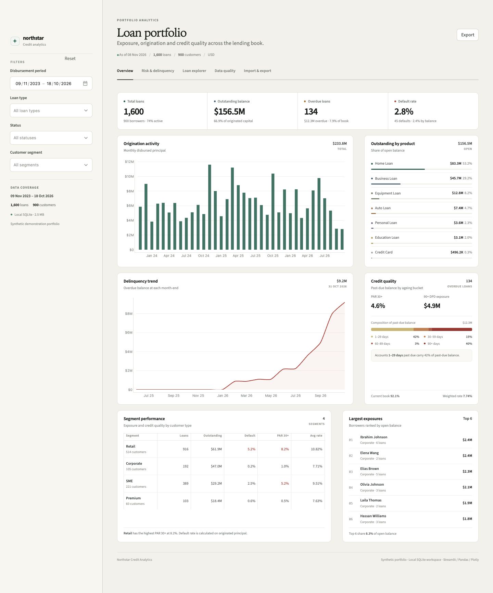
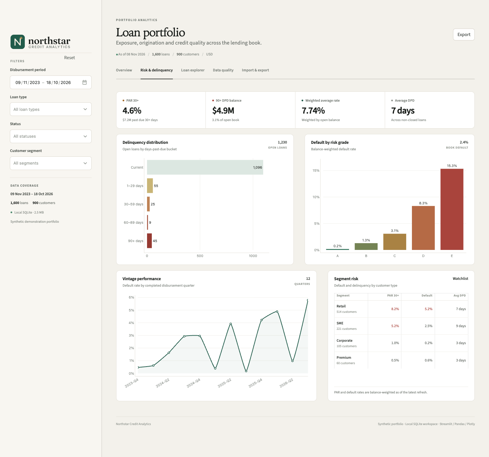
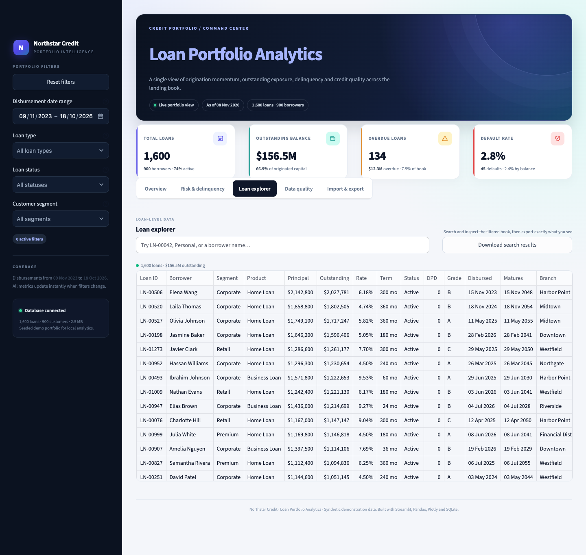
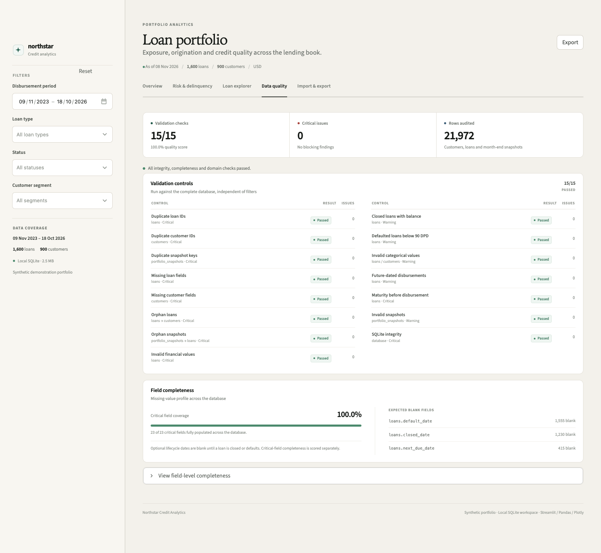
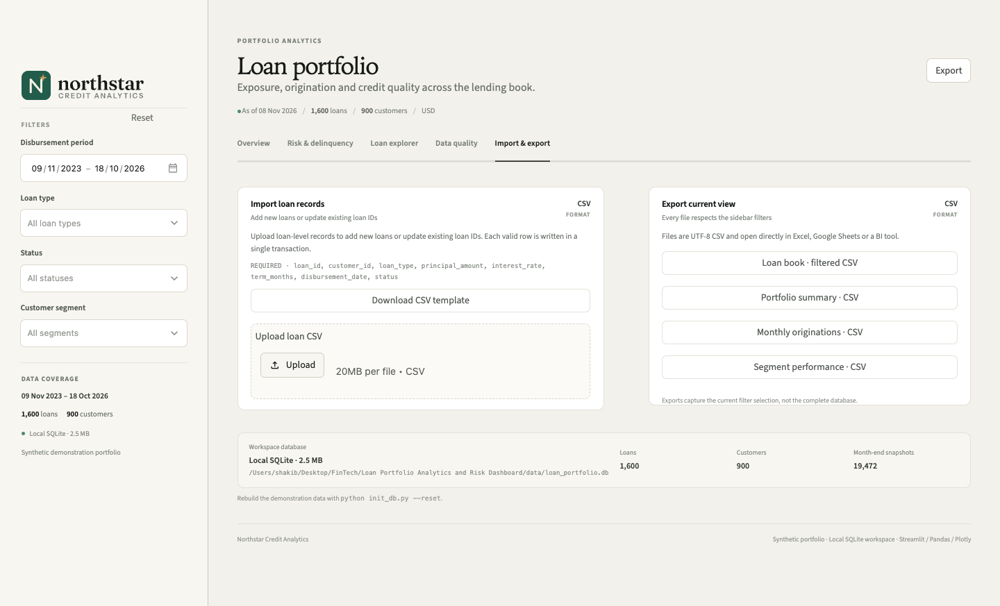

# User guide

This guide describes the dashboard from the user’s point of view: what each screen contains, how filters behave, and how to complete the main CSV tasks.

The interface is a single Streamlit workspace. Filters in the sidebar apply to all five analytical tabs.



---

## Page anatomy

| Region | Purpose |
|---|---|
| Logo and filter sidebar | Brand, disbursement period, loan type, status, customer segment, reset action and database coverage |
| Page header | Portfolio title, as-of date, loan/customer counts, active-filter count and a direct **Export** action |
| Tab navigation | Overview, Risk & delinquency, Loan explorer, Data quality and Import & export |
| Workspace | Metrics, charts, analytical summaries and data operations for the selected tab |
| Footer | Brand and local workspace attribution |

The **Export** button in the page header downloads the full loan-level export for the current filter selection. It uses the same data as the “Loan book” export in Import & export.

---

## Sidebar filters

All filters are applied through SQL before any metric is calculated.

### Disbursement period

An inclusive date range applied to `loans.disbursement_date`. The default is the full date coverage of the portfolio.

The period answers: “Which loans were originated in this window?” It does **not** filter balances to a point-in-time date. If you need a historical as-of view, use the month-end overdue-trend snapshot view and interpret it as the current filtered cohort.

### Loan type

Multi-select over the seven supported products:

- Personal Loan
- Home Loan
- Auto Loan
- Education Loan
- Business Loan
- Equipment Loan
- Credit Card

An empty selection means all products. This is intentional and applies to every multi-select.

### Status

Multi-select over:

- Active
- Closed
- Defaulted

An empty selection means all statuses.

Status filters are based on the current loan status, including in snapshot-trend queries. Selecting `Defaulted` shows the current defaulted population across the trend history.

### Customer segment

Multi-select over:

- Retail
- SME
- Corporate
- Premium

An empty selection means all segments; the selected segments are joined through the customer master.

### Reset and active filters

- **Reset** appears at the top right of the Filters section and clears all four filter dimensions.
- When any dimension differs from the default, the page header displays an active-filter chip such as “1 filter applied.”
- The sidebar note “Selections apply to every view” appears when a filter is active.
- The active-filter count treats a narrowed date range or a non-empty multi-select as one active dimension each.

### Data coverage

The sidebar footer shows the disbursement-date coverage, total scope counts, database size and synthetic-demo status. Counts update after a successful CSV import.

---

## Overview

The Overview is the primary portfolio-management surface.

### Metric rail

| Metric | Primary value | Supporting context |
|---|---|---|
| Total loans | Count of filtered loans | Borrower count and active share |
| Outstanding balance | Open principal balance | Share of originated capital |
| Overdue loans | Non-closed loans with DPD > 0 | Overdue balance and share of book |
| Default rate | Defaulted loans / total loans | Count of defaults and balance-based rate |

The coloured dots are context markers; interactive detail is provided by the charts and hover states described below.

### Origination activity

A monthly bar chart of disbursed principal across the selected period. Hovering the chart reveals the month, disbursed amount and number of loans originated. The card header shows total disbursed amount in the selection.

Use it to spot:

- origination concentration in a few months;
- a drop in lending activity;
- the relationship between recent originations and current risk metrics.

Because the chart groups by disbursement month, it does not show repayments or principal run-off.

### Outstanding by product

A compact allocation list sorted by current open balance. For each product:

- the open balance;
- the share of total open balance;
- a proportional bar for visual comparison.

This is a balance-share view, not an origination-count view. A product can be a small share of records but a large share of exposure (or vice versa).

### Delinquency trend

A month-end line/area chart of overdue balance. The header shows the latest completed snapshot balance and its date. The chart also includes the number of overdue loans in its hover data.

Key behaviours:

- uses the `portfolio_snapshots` table;
- periods are completed month-ends;
- filter semantics use the current loan and customer attributes;
- the latest point is a completed month-end, not today;
- card header date makes the reporting basis explicit.

### Credit quality

A compact panel showing:

- PAR 30+ rate;
- 90+ DPD exposure;
- composition of past-due balance by DPD bucket;
- the leading overdue bucket;
- current-book share;
- balance-weighted average interest rate.

This panel mixes denominators by design. The labels clarify when a percentage refers to total open balance, overdue balance or current balance. Read the documented [metric definitions](metrics.md) before using the panel in external reporting.

### Segment performance

A typography-led table with:

- segment;
- number of loans;
- open balance;
- balance-based default rate;
- PAR 30+;
- unweighted average rate.

The footer identifies the segment with the highest PAR 30+. Warning/risk colouring is presentation-level emphasis, not a regulatory classification.

### Largest exposures

A ranked list of the six largest borrower exposures in the selected portfolio. Each row shows:

- borrower name;
- segment and loan count;
- open exposure;
- a DPD or default indicator where applicable.

The footer quantifies the concentration of the top six as a share of total open balance.

---

## Risk & delinquency



This tab concentrates on delinquency severity and credit quality.

### Risk metric rail

- PAR 30+ rate and balance;
- 90+ DPD exposure and share of open book;
- weighted average rate;
- average DPD.

### Delinquency distribution

A horizontal bar chart of open loans grouped into:

- Current;
- 1–29 DPD;
- 30–59 DPD;
- 60–89 DPD;
- 90+ DPD.

Hovering reveals each bucket’s open balance. The current bucket is typically much larger than the overdue buckets; that is why the bar chart uses counts rather than balances. The credit-quality panel on Overview shows the balance-weighted composition instead.

### Default by risk grade

A balance-weighted default-rate bar chart for grades A–E, with default-rate labels and hover data for loan count and outstanding balance.

Do not compare grade-level default rates without checking the underlying exposure. A high rate on a very small exposure is different from a high rate on a large, growing segment.

### Vintage performance

A line chart of balance-weighted default rate by completed disbursement quarter. The current, incomplete quarter is excluded. The card header reports the number of completed quarters in the chart.

Use this view as a directional underwriting-quality proxy, not a full survival or loss-curve analysis. See [Metrics → Vintage analytics](metrics.md#vintage-analytics).

### Segment risk

A compact table of segment-level PAR 30+, balance-based default rate and average DPD. This is intended for a fast watch-list scan rather than a substitute for a detailed segment review.

---

## Loan explorer



The explorer exposes the current filtered loan book and supports free-text search.

### Search

Search is case-insensitive and matches partial text in:

- loan ID;
- borrower name;
- customer ID;
- product;
- purpose.

The search operates after the sidebar filters, so the result is “search within the filtered population.” It is a local, in-memory search over the query result; it does not use full-text database indexing.

### Result summary

Above the table, the dashboard shows:

- number of matching loans;
- current outstanding balance of non-closed matching loans.

### Columns

The visible table is intentionally narrower than the downloadable export:

- Loan ID
- Borrower
- Segment
- Product
- Principal
- Outstanding
- Rate
- Status
- DPD
- Grade
- Disbursed date

The CSV export contains additional fields from the loan table, including customer ID, purpose and maturity date where applicable. The header **Export** also downloads the full filtered loan book.

### Export search

Downloads the loans currently matching both the sidebar filters and the search term, not the full database.

---

## Data quality



The quality center audits the complete database, not just the filtered view.

### Summary rail

- number of checks passed;
- critical issue count;
- number of rows audited.

### Validation controls

A two-column list of every check with:

- control name;
- scope (table or relationship);
- severity (`Critical` or `Warning`);
- result pill (`Passed` / `Review`);
- issue count.

If a check needs review, its finding appears inline. The checks are read-only. A review result requires an operator to inspect and correct the source data rather than using the dashboard to repair it.

### Field completeness

The panel shows:

- **critical field coverage**;
- count of fully populated critical fields;
- **expected blank fields** with their missing counts;
- a note explaining optional lifecycle dates.

The seeded database has complete critical fields. Blank `default_date`, `closed_date` and `next_due_date` values are expected for some lifecycle states. This is why the overall quality checks pass despite those fields having missing values.

### Full field completeness

Open the “View field-level completeness” expander to see every column, missing count, row count, completeness percentage and critical flag. Optional fields are not treated as critical.

---

## Import & export



### Import loans

1. Open **Import & export**.
2. Download the CSV template if you want a guaranteed header layout.
3. Upload a UTF-8 CSV (up to 20 MB in the UI).
4. Review the validation summary:
   - valid rows;
   - invalid rows;
   - new loan IDs;
   - loan IDs that will update existing records.
5. Review any issue table. Invalid rows are skipped; valid rows can still be imported.
6. Inspect the normalized preview.
7. Select **Import N validated loan(s)**.
8. On success, the app reruns and updates the page counts and analytical views.

Required columns:

```text
loan_id, customer_id, loan_type, principal_amount, interest_rate,
term_months, disbursement_date, status
```

The customer must already exist in the `customers` table. Customer CSV import is not implemented in this demo.

Existing loan IDs are intentionally **updated**. Use this for corrections and scheduled upserts; use unique IDs for new records.

The full validation and defaulting contract is in [Data model → CSV contract](data-model.md#csv-contract).

### Import result state

After a successful import, the page shows a success summary and an **Import another file** button. The summary remains visible until you choose to import another file.

### Exports

All exports respect the sidebar filters.

| Export | Contents |
|---|---|
| Header **Export** | Full filtered loan book |
| Loan explorer **Export search** | Filtered loans matching the current search |
| Loan book · filtered CSV | Full filtered loan book |
| Portfolio summary · CSV | KPI metric/value table |
| Monthly originations · CSV | Month, loan count, disbursed amount, outstanding, defaults |
| Segment performance · CSV | Segment metrics and rates |

The **Loan explorer** export uses the search-filtered set. The other operational exports use the sidebar-filtered set.

Exports are UTF-8 CSV and open directly in spreadsheet and BI tools.

---

## Common workflows

### Monthly portfolio review

1. Keep the full date range or select the relevant origination window.
2. Review headline metrics and the overdue trend.
3. Switch to **Risk & delinquency** and inspect PAR 30+, DPD buckets and completed-vintage default rate.
4. Compare segment-level PAR and default rates.
5. Export the segment scorecard for the committee pack.

### Investigate a rise in overdue balances

1. Compare the headline overdue balance with the latest month-end trend.
2. Review the DPD distribution to see whether the increase is concentrated in early or late buckets.
3. Check the past-due composition card: a rise driven by 90+ balances has different implications from a rise in 1–29 balances.
4. Filter by segment or product to locate the source.
5. Use **Loan explorer** to identify affected loans and export the search result.

### Verify data before analysis

1. Open **Data quality**.
2. Confirm all critical checks are passed and there are no critical issues.
3. Review expected blank fields.
4. Open the full field-level table if a field seems unexpectedly incomplete.
5. Resolve source problems before drawing conclusions from the dashboard.

### Load a correction file

1. Use an existing `loan_id` to update a loan.
2. Confirm it appears in the “updates” count during validation.
3. Import and verify the changed totals.
4. Remember that only the latest completed month-end snapshot is refreshed for the imported loan.

### Export for a downstream report

1. Apply sidebar filters.
2. Use the header **Export** for the loan-level dataset or the relevant tailored export.
3. For the explorer’s search result, use **Export search**.
4. Document the filter state and as-of date alongside the file.

---

## Empty and error states

- **No filtered data** — a warning tells the user to clear filters or widen the period; metrics show zero and cards show empty states.
- **Empty search** — the explorer reports that no loans match and does not show a table.
- **Invalid CSV header** — no rows are validated or written; the issue identifies missing columns.
- **Invalid rows** — row-level errors are shown; valid rows can still be submitted.
- **Empty database** — the app stops with a clear instruction to rebuild via `python init_db.py --reset`.
- **Database bootstrap failure** — a page-level error identifies the initialization problem.

---

## Responsive behaviour

- The page header is compact and uses a full-width export button on small screens.
- Analytical columns stack below 1,100 px.
- The metric rail becomes a 2×2 grid below 900 px.
- The sidebar auto-collapses on smaller viewports; a fixed chevron button restores it.
- Custom tables hide the final rate column on small screens.
- The explorer table remains horizontally scrollable for the underlying columns.

---

## Power-user notes

- Filter selections are stored in the browser session and survive widget reruns.
- Clearing the browser session resets the filters.
- The analytical queries are not cached, so imported rows appear immediately on the next rerun.
- The page does not provide ad hoc SQL. All analysis is constrained to the shipped query layer.
- The data-quality audit is intentionally global; it does not silently narrow to the selected filters.

## Related documentation

- [Metrics and analytics](metrics.md)
- [Data model](data-model.md)
- [Operations](operations.md)
- [Implementation guide](implementation-guide.md)
