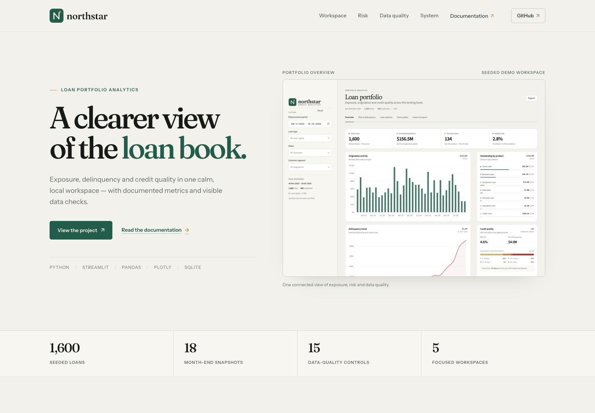

# Northstar landing page



A static Cloudflare Pages landing page for the Northstar project. It uses the same warm neutral, evergreen and paper palette as the application, with the Fraunces / Instrument Sans brand typography.

## Structure

```text
landing/
├── index.html
├── styles.css
├── script.js
├── _headers
├── robots.txt
└── assets/
    ├── screenshots/
    ├── fonts/
    └── licenses/
```

Everything is static. There is no build step, package installation, external font service or API dependency.

## Deploy with Cloudflare Pages

### Dashboard

1. In Cloudflare, open **Workers & Pages → Create → Pages → Connect to Git**.
2. Choose the `Mo-Shakib/Northstar` repository.
3. Select the **`landing-page`** branch.
4. Framework preset: **None**.
5. Build command: leave blank.
6. Build output directory: **`landing`**.
7. Deploy.

Set the Pages project's production branch to `landing-page` if this branch should be the primary site. Alternatively, keep it as a preview branch until the site has been reviewed.

### Wrangler

From the repository root, after authenticating Wrangler:

```bash
npx wrangler pages deploy landing --project-name northstar-landing
```

Add a custom domain in the Pages project settings if required.

## Preview locally

```bash
cd landing
python3 -m http.server 8080
```

Then open <http://localhost:8080>.

## Content and links

- All outbound documentation links point to the `main` branch of the GitHub repository.
- Update the repository links if the project moves.
- The footer credit links to <https://shakibmolla.com/>.
- The social-card image is intentionally referenced with a relative URL for portable previewing; replace it with an absolute production URL when a custom domain is set.

## Assets

Screenshots were derived from the app’s final sanitized demo database. Fonts are self-hosted subsets of Fraunces and Instrument Sans under the SIL Open Font License; licences are included in `assets/licenses/`.
